# 独立图题核查：批次 1

## B001

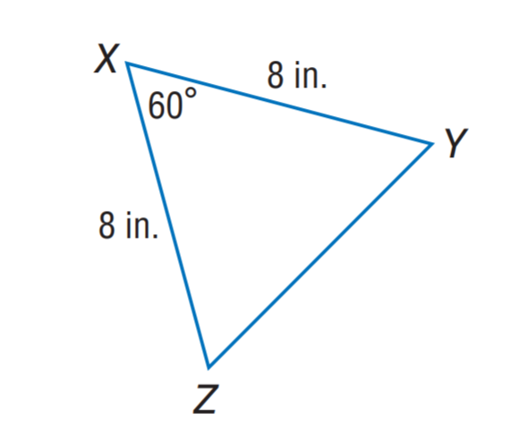

### 官方题干

Find Y Z.

### 官方标准答案

8

### 候选事实（逐条判断，不预设真假）

1. 角 YXZ（顶点 X）的标注角度为 60度
2. 线段 XY 的标注长度为 8（源未指定单位）
3. 线段 XZ 的标注长度为 8（源未指定单位）

### 对应 InterGPS 原始条件（图示）

```text
Equals(LengthOf(Line(Y, X)), 8)
Equals(MeasureOf(Angle(Y, X, Z)), 60)
Equals(LengthOf(Line(X, Z)), 8)
```

### 对应 InterGPS 原始条件（文字）

```text
Find(LengthOf(Line(Y,Z)))
```


---

## B002

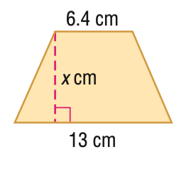

### 官方题干

Find x. A = 78 cm^2.

### 官方标准答案

8.0

### 候选事实（逐条判断，不预设真假）

1. 线段 AD 的标注长度为 32/5（源未指定单位）
2. 线段 BC 的标注长度为 13（源未指定单位）
3. 线段 DE 的标注长度为 x（源未指定单位）
4. C、E 与 D、E 垂直
5. 点 E 在直线（B、C）上

### 对应 InterGPS 原始条件（图示）

```text
Equals(LengthOf(Line(A, D)), 6.4)
Equals(LengthOf(Line(C, B)), 13)
Equals(LengthOf(Line(D, E)), x)
PointLiesOnLine(E, Line(C, B))
Perpendicular(Line(D, E), Line(E, C))
```

### 对应 InterGPS 原始条件（文字）

```text
Equals(AreaOf(Shape(A)),78)
Find(x)
```


---

## B003

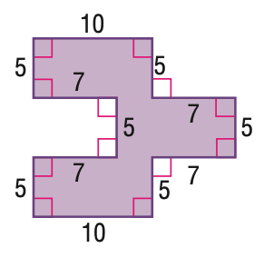

### 官方题干

Find the area of the figure.

### 官方标准答案

150

### 候选事实（逐条判断，不预设真假）

1. 线段 AG 的标注长度为 5（源未指定单位）
2. 线段 AK 的标注长度为 7（源未指定单位）
3. 线段 BI 的标注长度为 7（源未指定单位）
4. 线段 BL 的标注长度为 5（源未指定单位）
5. 线段 CF 的标注长度为 5（源未指定单位）
6. 线段 CJ 的标注长度为 10（源未指定单位）
7. 线段 DG 的标注长度为 7（源未指定单位）
8. 线段 DJ 的标注长度为 5（源未指定单位）
9. 线段 EH 的标注长度为 10（源未指定单位）
10. 线段 EI 的标注长度为 5（源未指定单位）
11. 线段 FL 的标注长度为 7（源未指定单位）
12. 线段 HK 的标注长度为 5（源未指定单位）
13. A、G 与 A、K 垂直
14. A、G 与 D、G 垂直
15. A、K 与 H、K 垂直
16. B、I 与 B、L 垂直
17. B、I 与 E、I 垂直
18. B、L 与 F、L 垂直
19. C、F 与 C、J 垂直
20. C、F 与 F、L 垂直
21. C、J 与 D、J 垂直
22. D、G 与 D、J 垂直
23. E、H 与 E、I 垂直
24. E、H 与 H、K 垂直
25. 点 B 在直线（A、I）上
26. 点 B 在直线（I、K）上
27. 点 D 在直线（F、G）上
28. 点 D 在直线（G、L）上
29. 点 D 在直线（H、J）上
30. 点 D 在直线（J、K）上
31. 点 F 在直线（C、E）上
32. 点 F 在直线（C、I）上
33. 点 I 在直线（C、E）上
34. 点 I 在直线（E、F）上
35. 点 K 在直线（A、B）上
36. 点 K 在直线（A、I）上
37. 点 K 在直线（D、H）上
38. 点 K 在直线（H、J）上
39. 点 L 在直线（D、F）上
40. 点 L 在直线（F、G）上

### 对应 InterGPS 原始条件（图示）

```text
Equals(LengthOf(Line(E, H)), 10)
Equals(LengthOf(Line(K, H)), 5)
Equals(LengthOf(Line(I, E)), 5)
Equals(LengthOf(Line(B, I)), 7)
Equals(LengthOf(Line(A, K)), 7)
Equals(LengthOf(Line(B, L)), 5)
Equals(LengthOf(Line(A, G)), 5)
Equals(LengthOf(Line(L, F)), 7)
Equals(LengthOf(Line(G, D)), 7)
Equals(LengthOf(Line(C, F)), 5)
Equals(LengthOf(Line(J, D)), 5)
Equals(LengthOf(Line(C, J)), 10)
PointLiesOnLine(K, Line(A, B))
PointLiesOnLine(B, Line(A, I))
PointLiesOnLine(K, Line(A, I))
PointLiesOnLine(D, Line(G, F))
PointLiesOnLine(L, Line(G, F))
PointLiesOnLine(D, Line(G, L))
PointLiesOnLine(F, Line(I, C))
PointLiesOnLine(B, Line(I, K))
PointLiesOnLine(D, Line(K, J))
PointLiesOnLine(F, Line(C, E))
PointLiesOnLine(I, Line(C, E))
PointLiesOnLine(I, Line(E, F))
PointLiesOnLine(L, Line(F, D))
PointLiesOnLine(D, Line(J, H))
PointLiesOnLine(K, Line(J, H))
PointLiesOnLine(K, Line(D, H))
Perpendicular(Line(E, H), Line(I, E))
Perpendicular(Line(E, H), Line(K, H))
Perpendicular(Line(I, E), Line(B, I))
Perpendicular(Line(K, H), Line(A, K))
Perpendicular(Line(B, I), Line(B, L))
Perpendicular(Line(A, K), Line(A, G))
Perpendicular(Line(B, L), Line(L, F))
Perpendicular(Line(A, G), Line(G, D))
Perpendicular(Line(L, F), Line(C, F))
Perpendicular(Line(G, D), Line(J, D))
Perpendicular(Line(C, F), Line(C, J))
Perpendicular(Line(J, D), Line(C, J))
```

### 对应 InterGPS 原始条件（文字）

```text
Find(AreaOf(Shape($)))
```


---

## B004

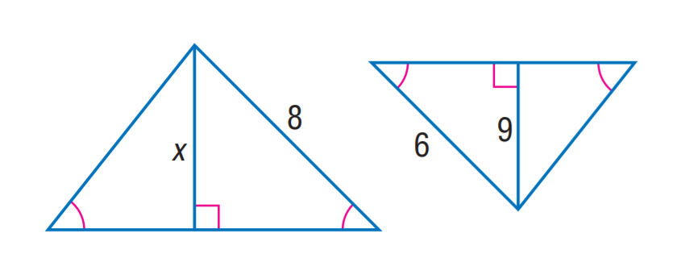

### 官方题干

Find x.

### 官方标准答案

12

### 候选事实（逐条判断，不预设真假）

1. B、A、C 与 B、V、C 角度相等
2. B、V、C 与 H、G、J 角度相等
3. H、G、J 与 H、I、J 角度相等
4. 线段 BC 的标注长度为 x（源未指定单位）
5. 线段 BV 的标注长度为 8（源未指定单位）
6. 线段 GJ 的标注长度为 6（源未指定单位）
7. 线段 HJ 的标注长度为 9（源未指定单位）
8. B、C 与 C、V 垂直
9. G、H 与 H、J 垂直
10. 点 C 在直线（A、V）上
11. 点 I 在直线（G、H）上

### 对应 InterGPS 原始条件（图示）

```text
Equals(LengthOf(Line(V, B)), 8)
Equals(LengthOf(Line(H, J)), 9)
Equals(LengthOf(Line(G, J)), 6)
Equals(LengthOf(Line(B, C)), x)
PointLiesOnLine(C, Line(A, V))
PointLiesOnLine(I, Line(G, H))
Perpendicular(Line(B, C), Line(V, C))
Perpendicular(Line(G, H), Line(H, J))
Equals(MeasureOf(Angle(B, A, C)), MeasureOf(Angle(B, V, C)))
Equals(MeasureOf(Angle(H, G, J)), MeasureOf(Angle(B, V, C)))
Equals(MeasureOf(Angle(H, G, J)), MeasureOf(Angle(H, I, J)))
```

### 对应 InterGPS 原始条件（文字）

```text
Find(x)
```


---

## B005

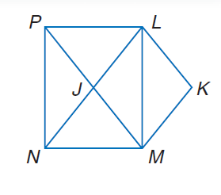

### 官方题干

Use rectangle L M N P, parallelogram L K M J to solve the problem. If M K = 6 x, K L = 3 x + 2 y, and J N = 14 - x, find x.

### 官方标准答案

2

### 候选事实（逐条判断，不预设真假）

1. 点 J 在直线（L、N）上
2. 点 J 在直线（M、P）上

### 对应 InterGPS 原始条件（图示）

```text
PointLiesOnLine(J, Line(P, M))
PointLiesOnLine(J, Line(L, N))
```

### 对应 InterGPS 原始条件（文字）

```text
Rectangle(L,M,N,P)
Parallelogram(L,K,M,J)
Equals(LengthOf(Line(M,K)),6x)
Equals(LengthOf(Line(K,L)),3x+2y)
Equals(LengthOf(Line(J,N)),14-x)
Find(x)
```


---

## B006

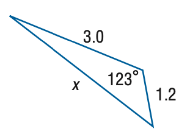

### 官方题干

Find x. Round the side measure to the nearest tenth.

### 官方标准答案

3.8

### 候选事实（逐条判断，不预设真假）

1. 角 BAC（顶点 A）的标注角度为 123度
2. 线段 AB 的标注长度为 3（源未指定单位）
3. 线段 AC 的标注长度为 6/5（源未指定单位）
4. 线段 BC 的标注长度为 x（源未指定单位）

### 对应 InterGPS 原始条件（图示）

```text
Equals(LengthOf(Line(A, B)), 3.0)
Equals(MeasureOf(Angle(C, A, B)), 123)
Equals(LengthOf(Line(B, C)), x)
Equals(LengthOf(Line(A, C)), 1.2)
```

### 对应 InterGPS 原始条件（文字）

```text
Find(x)
```


---

## B007

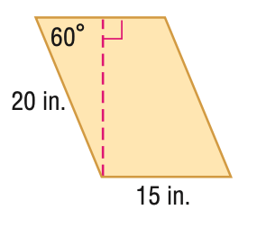

### 官方题干

Find the area of the parallelogram. Round to the nearest tenth if necessary.

### 官方标准答案

259.8

### 候选事实（逐条判断，不预设真假）

1. 角 ECO（顶点 C）的标注角度为 60度
2. 线段 BO 的标注长度为 15（源未指定单位）
3. 线段 CO 的标注长度为 20（源未指定单位）
4. A、E 与 E、O 垂直
5. 点 E 在直线（A、C）上

### 对应 InterGPS 原始条件（图示）

```text
Equals(MeasureOf(Angle(E, C, O)), 60)
Equals(LengthOf(Line(C, O)), 20)
Equals(LengthOf(Line(B, O)), 15)
PointLiesOnLine(E, Line(C, A))
Perpendicular(Line(O, E), Line(E, A))
```

### 对应 InterGPS 原始条件（文字）

```text
Find(AreaOf(Parallelogram($)))
```


---

## B008

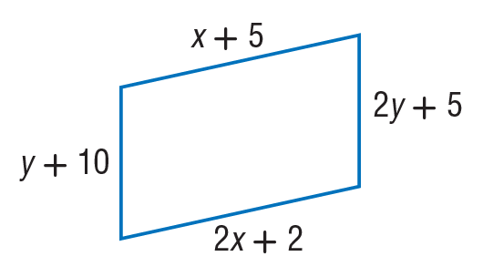

### 官方题干

Find y so that the quadrilateral is a parallelogram.

### 官方标准答案

5

### 候选事实（逐条判断，不预设真假）

1. 线段 AC 的标注长度为 2*x + 2（源未指定单位）
2. 线段 AD 的标注长度为 y + 10（源未指定单位）
3. 线段 BC 的标注长度为 2*y + 5（源未指定单位）
4. 线段 BD 的标注长度为 x + 5（源未指定单位）

### 对应 InterGPS 原始条件（图示）

```text
Equals(LengthOf(Line(D, B)), x+5)
Equals(LengthOf(Line(C, B)), 2y+5)
Equals(LengthOf(Line(A, D)), y+10)
Equals(LengthOf(Line(A, C)), 2x+2)
```

### 对应 InterGPS 原始条件（文字）

```text
Parallelogram($)
Find(y)
```


---

## B009

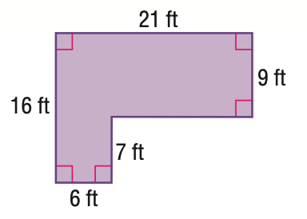

### 官方题干

Find the area of the figure. Round to the nearest tenth.

### 官方标准答案

231

### 候选事实（逐条判断，不预设真假）

1. 线段 AD 的标注长度为 21（源未指定单位）
2. 线段 AE 的标注长度为 16（源未指定单位）
3. 线段 BE 的标注长度为 6（源未指定单位）
4. 线段 BF 的标注长度为 7（源未指定单位）
5. 线段 CD 的标注长度为 9（源未指定单位）
6. A、D 与 A、E 垂直
7. A、D 与 C、D 垂直
8. A、E 与 B、E 垂直
9. B、E 与 B、F 垂直
10. C、D 与 C、F 垂直

### 对应 InterGPS 原始条件（图示）

```text
Equals(LengthOf(Line(A, D)), 21)
Equals(LengthOf(Line(D, C)), 9)
Equals(LengthOf(Line(A, E)), 16)
Equals(LengthOf(Line(B, F)), 7)
Equals(LengthOf(Line(E, B)), 6)
Perpendicular(Line(A, D), Line(A, E))
Perpendicular(Line(A, D), Line(D, C))
Perpendicular(Line(D, C), Line(F, C))
Perpendicular(Line(A, E), Line(E, B))
Perpendicular(Line(B, F), Line(E, B))
```

### 对应 InterGPS 原始条件（文字）

```text
Find(AreaOf(Shape($)))
```


---

## B010

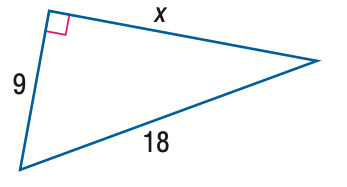

### 官方题干

Find x.

### 官方标准答案

9 \sqrt { 3 }

### 候选事实（逐条判断，不预设真假）

1. 线段 AB 的标注长度为 18（源未指定单位）
2. 线段 AC 的标注长度为 9（源未指定单位）
3. 线段 BC 的标注长度为 x（源未指定单位）
4. A、C 与 B、C 垂直

### 对应 InterGPS 原始条件（图示）

```text
Equals(LengthOf(Line(B, C)), x)
Equals(LengthOf(Line(A, C)), 9)
Equals(LengthOf(Line(A, B)), 18)
Perpendicular(Line(B, C), Line(A, C))
```

### 对应 InterGPS 原始条件（文字）

```text
Find(x)
```


---

## B011

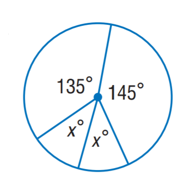

### 官方题干

Find x.

### 官方标准答案

40

### 候选事实（逐条判断，不预设真假）

1. 角 BGD（顶点 G）的标注角度为 145度
2. 角 BGE（顶点 G）的标注角度为 x度
3. 角 CGD（顶点 G）的标注角度为 135度
4. 角 CGE（顶点 G）的标注角度为 x度
5. 点 B 在 圆（源圆心名 G；源圆区分记号 radius_6_0，是否可见待核） 上
6. 点 C 在 圆（源圆心名 G；源圆区分记号 radius_6_0，是否可见待核） 上
7. 点 D 在 圆（源圆心名 G；源圆区分记号 radius_6_0，是否可见待核） 上
8. 点 E 在 圆（源圆心名 G；源圆区分记号 radius_6_0，是否可见待核） 上

### 对应 InterGPS 原始条件（图示）

```text
Equals(MeasureOf(Angle(C, G, D)), 135)
Equals(MeasureOf(Angle(D, G, B)), 145)
Equals(MeasureOf(Angle(C, G, E)), x)
Equals(MeasureOf(Angle(E, G, B)), x)

PointLiesOnCircle(B, Circle(G, radius_6_0))
PointLiesOnCircle(C, Circle(G, radius_6_0))
PointLiesOnCircle(D, Circle(G, radius_6_0))
PointLiesOnCircle(E, Circle(G, radius_6_0))
```

### 对应 InterGPS 原始条件（文字）

```text
Find(x)
```


---

## B012

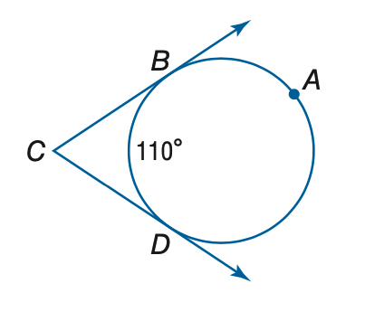

### 官方题干

Find the measure of m \angle C.

### 官方标准答案

70

### 候选事实（逐条判断，不预设真假）

1. 角 BFD（顶点 F）的标注角度为 110度
2. 点 B 在 圆（源圆心名 F；源圆区分记号 radius_3_0，是否可见待核） 上
3. 点 D 在 圆（源圆心名 F；源圆区分记号 radius_3_0，是否可见待核） 上
4. 点 B 在直线（A、C）上
5. 点 D 在直线（C、E）上

### 对应 InterGPS 原始条件（图示）

```text
Equals(MeasureOf(Angle(B, F, D)), 110)
PointLiesOnLine(D, Line(C, E))
PointLiesOnLine(B, Line(C, A))
PointLiesOnCircle(B, Circle(F, radius_3_0))
PointLiesOnCircle(D, Circle(F, radius_3_0))
```

### 对应 InterGPS 原始条件（文字）

```text
Find(MeasureOf(Angle(C)))
```


---

## B013

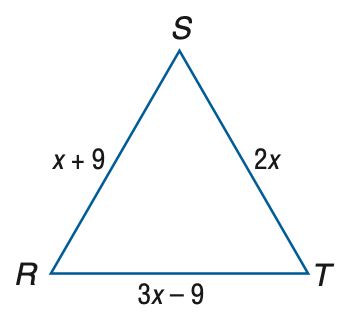

### 官方题干

Find the measure of S T of equilateral triangle R S T if R S = x + 9, S T = 2 x, and R T = 3 x - 9.

### 官方标准答案

18

### 候选事实（逐条判断，不预设真假）

1. 线段 AR 的标注长度为 x + 9（源未指定单位）
2. 线段 AT 的标注长度为 2*x（源未指定单位）

### 对应 InterGPS 原始条件（图示）

```text
Equals(LengthOf(Line(T, A)), 2x)
Equals(LengthOf(Line(R, A)), x+9)
Equals(LengthOf(Line(R, T)), 3x-9)
```

### 对应 InterGPS 原始条件（文字）

```text
Equilateral(Triangle(R,S,T))
Equals(LengthOf(Line(R,S)),x+9)
Equals(LengthOf(Line(S,T)),2x)
Equals(LengthOf(Line(R,T)),3x-9)
Find(LengthOf(Line(S,T)))
```


---

## B014

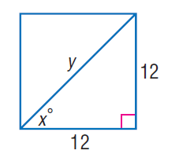

### 官方题干

Find y.

### 官方标准答案

12 \sqrt { 2 }

### 候选事实（逐条判断，不预设真假）

1. 角 BAD（顶点 A）的标注角度为 x度
2. 线段 AB 的标注长度为 y（源未指定单位）
3. 线段 AD 的标注长度为 12（源未指定单位）
4. 线段 BD 的标注长度为 12（源未指定单位）
5. A、D 与 B、D 垂直

### 对应 InterGPS 原始条件（图示）

```text
Equals(LengthOf(Line(A, B)), y)
Equals(LengthOf(Line(B, D)), 12)
Equals(MeasureOf(Angle(B, A, D)), x)
Equals(LengthOf(Line(A, D)), 12)
Perpendicular(Line(B, D), Line(A, D))
```

### 对应 InterGPS 原始条件（文字）

```text
Find(y)
```


---

## B015

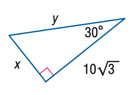

### 官方题干

Find y.

### 官方标准答案

20

### 候选事实（逐条判断，不预设真假）

1. 角 BAC（顶点 A）的标注角度为 30度
2. 线段 AB 的标注长度为 y（源未指定单位）
3. 线段 AC 的标注长度为 10*sqrt(3)（源未指定单位）
4. 线段 BC 的标注长度为 x（源未指定单位）
5. A、C 与 B、C 垂直

### 对应 InterGPS 原始条件（图示）

```text
Equals(LengthOf(Line(A, B)), y)
Equals(MeasureOf(Angle(C, A, B)), 30)
Equals(LengthOf(Line(B, C)), x)
Equals(LengthOf(Line(A, C)), 10\sqrt{3})
Perpendicular(Line(B, C), Line(A, C))
```

### 对应 InterGPS 原始条件（文字）

```text
Find(y)
```
