# 独立图题核查：批次 2

## B016

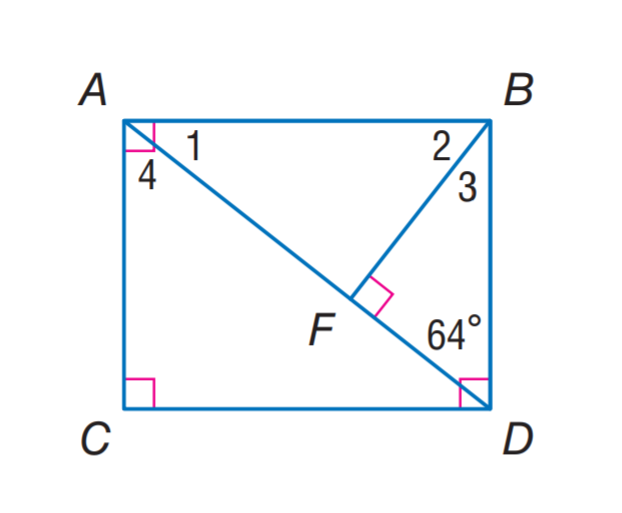

### 官方题干

Find m \angle 1.

### 官方标准答案

26

### 候选事实（逐条判断，不预设真假）

1. 角 ADB（顶点 D）的标注角度为 64度
2. A、B 与 A、C 垂直
3. A、C 与 C、G 垂直
4. B、D 与 D、E 垂直
5. B、F 与 D、F 垂直
6. 点 E 在直线（C、D）上
7. 点 E 在直线（D、G）上
8. 点 F 在直线（A、D）上
9. 点 G 在直线（C、D）上
10. 点 G 在直线（C、E）上

### 对应 InterGPS 原始条件（图示）

```text
Equals(MeasureOf(Angle(B, A, D)), MeasureOf(angle 1))
Equals(MeasureOf(Angle(F, B, A)), MeasureOf(angle 2))
Equals(MeasureOf(Angle(F, A, C)), MeasureOf(angle 4))
Equals(MeasureOf(Angle(D, B, F)), MeasureOf(angle 3))
Equals(MeasureOf(Angle(A, D, B)), 64)
PointLiesOnLine(G, Line(E, C))
PointLiesOnLine(E, Line(C, D))
PointLiesOnLine(G, Line(C, D))
PointLiesOnLine(F, Line(D, A))
PointLiesOnLine(E, Line(D, G))
Perpendicular(Line(A, B), Line(C, A))
Perpendicular(Line(B, F), Line(D, F))
Perpendicular(Line(C, A), Line(C, G))
Perpendicular(Line(D, B), Line(E, D))
```

### 对应 InterGPS 原始条件（文字）

```text
Find(MeasureOf(Angle(1)))
```


---

## B017

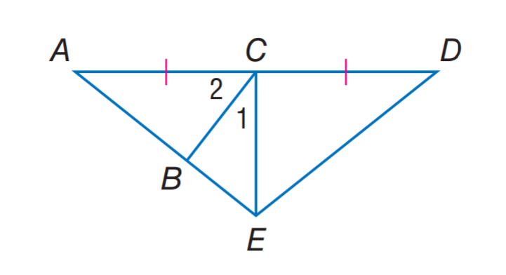

### 官方题干

If E C is an altitude of \triangle A E D, m \angle 1 = 2 x + 7, and m \angle 2 = 3 x + 13, find m \angle 2.

### 官方标准答案

55

### 候选事实（逐条判断，不预设真假）

1. A、C 与 C、D 等长
2. 点 B 在直线（A、E）上
3. 点 C 在直线（A、D）上

### 对应 InterGPS 原始条件（图示）

```text
Equals(MeasureOf(Angle(B, C, A)), MeasureOf(angle 2))
Equals(MeasureOf(Angle(E, C, B)), MeasureOf(angle 1))
PointLiesOnLine(B, Line(A, E))
PointLiesOnLine(C, Line(A, D))
Equals(LengthOf(Line(A, C)), LengthOf(Line(C, D)))
```

### 对应 InterGPS 原始条件（文字）

```text
Equals(Line(E,C),AltitudeOf(Triangle(A,E,D)))
Equals(MeasureOf(Angle(1)),2x+7)
Equals(MeasureOf(Angle(2)),3x+13)
Find(MeasureOf(Angle(2)))
```


---

## B018

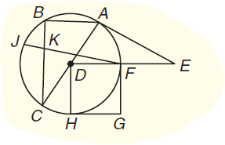

### 官方题干

A E is a tangent. If A D = 12 and F E = 18, how long is A E to the nearest tenth unit?

### 官方标准答案

27.5

### 候选事实（逐条判断，不预设真假）

1. 点 A 在 圆（源圆心名 D；源圆区分记号 radius_5_0，是否可见待核） 上
2. 点 B 在 圆（源圆心名 D；源圆区分记号 radius_5_0，是否可见待核） 上
3. 点 C 在 圆（源圆心名 D；源圆区分记号 radius_5_0，是否可见待核） 上
4. 点 F 在 圆（源圆心名 D；源圆区分记号 radius_5_0，是否可见待核） 上
5. 点 H 在 圆（源圆心名 D；源圆区分记号 radius_5_0，是否可见待核） 上
6. 点 J 在 圆（源圆心名 D；源圆区分记号 radius_5_0，是否可见待核） 上
7. 点 K 在 圆（源圆心名 D；源圆区分记号 radius_5_0，是否可见待核） 上
8. 点 L 在 圆（源圆心名 D；源圆区分记号 radius_5_0，是否可见待核） 上
9. 点 N 在 圆（源圆心名 D；源圆区分记号 radius_5_0，是否可见待核） 上
10. 点 A 在直线（E、L）上
11. 点 D 在直线（A、C）上
12. 点 D 在直线（C、M）上
13. 点 F 在直线（D、E）上
14. 点 H 在直线（G、N）上
15. 点 H 在直线（K、N）上
16. 点 I 在直线（B、C）上
17. 点 I 在直线（F、J）上
18. 点 I 在直线（J、M）上
19. 点 K 在直线（G、H）上
20. 点 K 在直线（G、N）上
21. 点 M 在直线（A、C）上
22. 点 M 在直线（A、D）上
23. 点 M 在直线（F、I）上
24. 点 M 在直线（F、J）上
25. 点 N 在直线（C、H）上

### 对应 InterGPS 原始条件（图示）

```text
Equals(LengthOf(Line(D, B)), LengthOf(k))
PointLiesOnLine(D, Line(A, C))
PointLiesOnLine(M, Line(A, C))
PointLiesOnLine(M, Line(A, D))
PointLiesOnLine(N, Line(C, H))
PointLiesOnLine(I, Line(C, B))
PointLiesOnLine(D, Line(C, M))
PointLiesOnLine(F, Line(E, D))
PointLiesOnLine(A, Line(E, L))
PointLiesOnLine(I, Line(M, J))
PointLiesOnLine(M, Line(F, I))
PointLiesOnLine(I, Line(F, J))
PointLiesOnLine(M, Line(F, J))
PointLiesOnLine(K, Line(G, H))
PointLiesOnLine(H, Line(G, N))
PointLiesOnLine(K, Line(G, N))
PointLiesOnLine(H, Line(K, N))
PointLiesOnCircle(A, Circle(D, radius_5_0))
PointLiesOnCircle(F, Circle(D, radius_5_0))
PointLiesOnCircle(C, Circle(D, radius_5_0))
PointLiesOnCircle(H, Circle(D, radius_5_0))
PointLiesOnCircle(B, Circle(D, radius_5_0))
PointLiesOnCircle(J, Circle(D, radius_5_0))
PointLiesOnCircle(K, Circle(D, radius_5_0))
PointLiesOnCircle(L, Circle(D, radius_5_0))
PointLiesOnCircle(N, Circle(D, radius_5_0))
```

### 对应 InterGPS 原始条件（文字）

```text
Tangent(Line(A,E),Circle($))
Equals(LengthOf(Line(A,D)),12)
Equals(LengthOf(Line(F,E)),18)
Find(LengthOf(Line(A,E)))
```


---

## B019

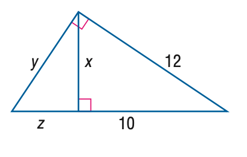

### 官方题干

Find z.

### 官方标准答案

\frac { 22 } { 5 }

### 候选事实（逐条判断，不预设真假）

1. 线段 AB 的标注长度为 12（源未指定单位）
2. 线段 AC 的标注长度为 10（源未指定单位）
3. 线段 BC 的标注长度为 y（源未指定单位）
4. 线段 BD 的标注长度为 x（源未指定单位）
5. 线段 CD 的标注长度为 z（源未指定单位）
6. A、B 与 B、C 垂直
7. A、D 与 B、D 垂直
8. 点 D 在直线（A、C）上

### 对应 InterGPS 原始条件（图示）

```text
Equals(LengthOf(Line(A, B)), 12)
Equals(LengthOf(Line(B, C)), y)
Equals(LengthOf(Line(B, D)), x)
Equals(LengthOf(Line(A, C)), 10)
Equals(LengthOf(Line(C, D)), z)
PointLiesOnLine(D, Line(A, C))
Perpendicular(Line(A, B), Line(B, C))
Perpendicular(Line(B, D), Line(A, D))
```

### 对应 InterGPS 原始条件（文字）

```text
Find(z)
```


---

## B020

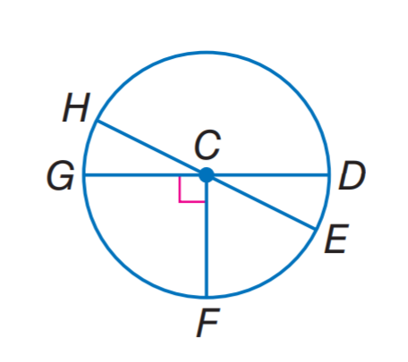

### 官方题干

In \odot C, m \angle H C G = 2 x and m \angle H C D = 6 x + 28, find m \widehat H G F.

### 官方标准答案

128

### 候选事实（逐条判断，不预设真假）

1. C、F 与 C、G 垂直
2. 点 D 在 圆（源圆心名 C；源圆区分记号 radius_0_0，是否可见待核） 上
3. 点 E 在 圆（源圆心名 C；源圆区分记号 radius_0_0，是否可见待核） 上
4. 点 F 在 圆（源圆心名 C；源圆区分记号 radius_0_0，是否可见待核） 上
5. 点 G 在 圆（源圆心名 C；源圆区分记号 radius_0_0，是否可见待核） 上
6. 点 H 在 圆（源圆心名 C；源圆区分记号 radius_0_0，是否可见待核） 上
7. 点 C 在直线（D、G）上
8. 点 C 在直线（E、H）上

### 对应 InterGPS 原始条件（图示）

```text
PointLiesOnLine(C, Line(D, G))
PointLiesOnLine(C, Line(E, H))
PointLiesOnCircle(D, Circle(C, radius_0_0))
PointLiesOnCircle(G, Circle(C, radius_0_0))
PointLiesOnCircle(F, Circle(C, radius_0_0))
PointLiesOnCircle(E, Circle(C, radius_0_0))
PointLiesOnCircle(H, Circle(C, radius_0_0))
Perpendicular(Line(G, C), Line(F, C))
```

### 对应 InterGPS 原始条件（文字）

```text
Circle(C)
Equals(MeasureOf(Angle(H,C,G)),2x)
Equals(MeasureOf(Angle(H,C,D)),6x+28)
Find(MeasureOf(Arc(H,G,F)))
```


---

## B021

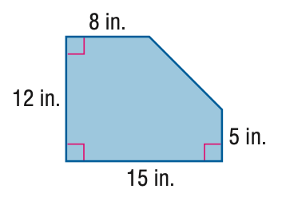

### 官方题干

Find the area of the figure. Round to the nearest tenth if necessary.

### 官方标准答案

155.5

### 候选事实（逐条判断，不预设真假）

1. 线段 AN 的标注长度为 5（源未指定单位）
2. 线段 BC 的标注长度为 12（源未指定单位）
3. 线段 BD 的标注长度为 8（源未指定单位）
4. 线段 CN 的标注长度为 15（源未指定单位）
5. A、N 与 C、N 垂直
6. B、C 与 B、D 垂直
7. B、C 与 C、N 垂直

### 对应 InterGPS 原始条件（图示）

```text
Equals(LengthOf(Line(A, N)), 5)
Equals(LengthOf(Line(B, D)), 8)
Equals(LengthOf(Line(B, C)), 12)
Equals(LengthOf(Line(C, N)), 15)
Perpendicular(Line(D, B), Line(B, C))
Perpendicular(Line(B, C), Line(N, C))
Perpendicular(Line(A, N), Line(N, C))
```

### 对应 InterGPS 原始条件（文字）

```text
Find(AreaOf(Shape($)))
```


---

## B022

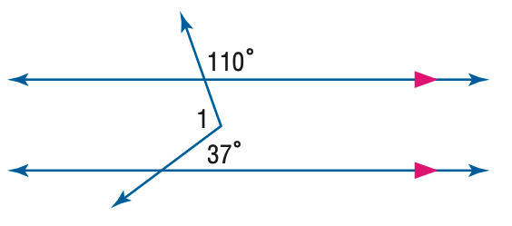

### 官方题干

Find m \angle 1 in the figure.

### 官方标准答案

107

### 候选事实（逐条判断，不预设真假）

1. 角 AHN（顶点 H）的标注角度为 37度
2. 角 EKL（顶点 K）的标注角度为 110度
3. G、J 与 I、M 平行
4. 点 B 在直线（G、J）上
5. 点 B 在直线（G、K）上
6. 点 B 在直线（J、L）上
7. 点 B 在直线（J、O）上
8. 点 B 在直线（K、L）上
9. 点 B 在直线（K、O）上
10. 点 D 在直线（C、I）上
11. 点 D 在直线（H、I）上
12. 点 D 在直线（I、M）上
13. 点 D 在直线（I、N）上
14. 点 H 在直线（A、F）上
15. 点 H 在直线（D、M）上
16. 点 H 在直线（I、M）上
17. 点 H 在直线（M、N）上
18. 点 K 在直线（A、E）上
19. 点 K 在直线（B、J）上
20. 点 K 在直线（G、J）上
21. 点 K 在直线（J、L）上
22. 点 K 在直线（J、O）上
23. 点 L 在直线（B、G）上
24. 点 L 在直线（G、J）上
25. 点 L 在直线（G、K）上
26. 点 N 在直线（C、D）上
27. 点 N 在直线（C、I）上
28. 点 N 在直线（D、H）上
29. 点 N 在直线（D、M）上
30. 点 N 在直线（H、I）上
31. 点 N 在直线（I、M）上
32. 点 O 在直线（B、G）上
33. 点 O 在直线（B、L）上
34. 点 O 在直线（G、J）上
35. 点 O 在直线（G、K）上

### 对应 InterGPS 原始条件（图示）

```text
Equals(MeasureOf(Angle(E, K, L)), 110)
Equals(MeasureOf(Angle(K, A, H)), MeasureOf(Angle(1)) )
Equals(MeasureOf(Angle(A, H, N)), 37)
PointLiesOnLine(K, Line(A, E))
PointLiesOnLine(H, Line(A, F))
PointLiesOnLine(N, Line(H, D))
PointLiesOnLine(D, Line(H, I))
PointLiesOnLine(N, Line(H, I))
PointLiesOnLine(B, Line(K, G))
PointLiesOnLine(L, Line(K, G))
PointLiesOnLine(O, Line(K, G))
PointLiesOnLine(B, Line(K, L))
PointLiesOnLine(B, Line(K, O))
PointLiesOnLine(L, Line(B, G))
PointLiesOnLine(O, Line(B, G))
PointLiesOnLine(K, Line(B, J))
PointLiesOnLine(O, Line(B, L))
PointLiesOnLine(B, Line(G, J))
PointLiesOnLine(K, Line(G, J))
PointLiesOnLine(L, Line(G, J))
PointLiesOnLine(O, Line(G, J))
PointLiesOnLine(B, Line(J, L))
PointLiesOnLine(K, Line(J, L))
PointLiesOnLine(B, Line(J, O))
PointLiesOnLine(K, Line(J, O))
PointLiesOnLine(N, Line(C, D))
PointLiesOnLine(D, Line(C, I))
PointLiesOnLine(N, Line(C, I))
PointLiesOnLine(H, Line(D, M))
PointLiesOnLine(N, Line(D, M))
PointLiesOnLine(D, Line(I, M))
PointLiesOnLine(H, Line(I, M))
PointLiesOnLine(N, Line(I, M))
PointLiesOnLine(D, Line(I, N))
PointLiesOnLine(H, Line(M, N))
Parallel(Line(J,G), Line(M,I))
```

### 对应 InterGPS 原始条件（文字）

```text
Find(MeasureOf(Angle(1)))
```


---

## B023

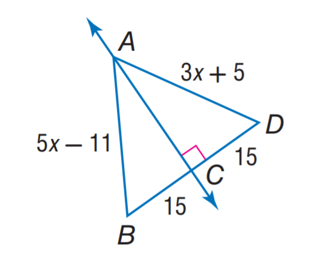

### 官方题干

Find A B.

### 官方标准答案

29

### 候选事实（逐条判断，不预设真假）

1. 线段 AB 的标注长度为 5*x - 11（源未指定单位）
2. 线段 AD 的标注长度为 3*x + 5（源未指定单位）
3. 线段 BF 的标注长度为 15（源未指定单位）
4. 线段 DF 的标注长度为 15（源未指定单位）
5. A、F 与 D、F 垂直
6. 点 A 在直线（F、G）上
7. 点 A 在直线（G、N）上
8. 点 F 在直线（A、N）上
9. 点 F 在直线（B、D）上
10. 点 F 在直线（E、N）上
11. 点 F 在直线（G、N）上
12. 点 F 在直线（H、N）上

### 对应 InterGPS 原始条件（图示）

```text
Equals(LengthOf(Line(D, A)), 3x+5)
Equals(LengthOf(Line(B, A)), 5x-11)
Equals(LengthOf(Line(D, F)), 15)
Equals(LengthOf(Line(B, F)), 15)
PointLiesOnLine(F, Line(B, D))
PointLiesOnLine(F, Line(A, N))
PointLiesOnLine(A, Line(F, G))
PointLiesOnLine(F, Line(E, N))
PointLiesOnLine(A, Line(N, G))
PointLiesOnLine(F, Line(N, G))
PointLiesOnLine(F, Line(N, H))
Perpendicular(Line(A, F), Line(D, F))
```

### 对应 InterGPS 原始条件（文字）

```text
Find(LengthOf(Line(A,B)))
```


---

## B024

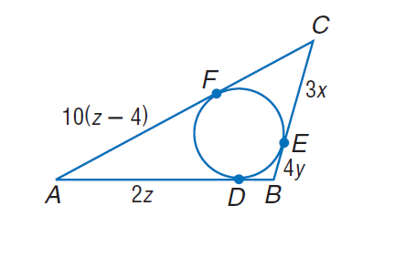

### 官方题干

Find the perimeter of the polygon for the given information. C F = 6(3 - x), D B = 12 y - 4.

### 官方标准答案

36

### 候选事实（逐条判断，不预设真假）

1. 线段 AD 的标注长度为 2*z（源未指定单位）
2. 线段 AF 的标注长度为 10*z - 40（源未指定单位）
3. 线段 BE 的标注长度为 4*y（源未指定单位）
4. 线段 CE 的标注长度为 3*x（源未指定单位）
5. 点 D 在 圆（源圆心名 G；源圆区分记号 radius_3_0，是否可见待核） 上
6. 点 E 在 圆（源圆心名 G；源圆区分记号 radius_3_0，是否可见待核） 上
7. 点 F 在 圆（源圆心名 G；源圆区分记号 radius_3_0，是否可见待核） 上
8. 点 D 在直线（A、B）上
9. 点 E 在直线（B、C）上
10. 点 F 在直线（A、C）上

### 对应 InterGPS 原始条件（图示）

```text
Equals(LengthOf(Line(E, C)), 3x)
Equals(LengthOf(Line(A, F)), 10z-40)
Equals(LengthOf(Line(E, B)), 4y)
Equals(LengthOf(Line(D, A)), 2z)
PointLiesOnLine(F, Line(C, A))
PointLiesOnLine(E, Line(C, B))
PointLiesOnLine(D, Line(B, A))
PointLiesOnCircle(E, Circle(G, radius_3_0))
PointLiesOnCircle(F, Circle(G, radius_3_0))
PointLiesOnCircle(D, Circle(G, radius_3_0))
```

### 对应 InterGPS 原始条件（文字）

```text
Equals(LengthOf(Line(C,F)),6(3-x))
Equals(LengthOf(Line(D,B)),12y-4)
Find(PerimeterOf(Polygon($)))
```


---

## B025

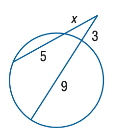

### 官方题干

Find x to the nearest tenth. 

### 官方标准答案

4

### 候选事实（逐条判断，不预设真假）

1. 线段 AD 的标注长度为 9（源未指定单位）
2. 线段 BD 的标注长度为 3（源未指定单位）
3. 线段 BF 的标注长度为 x（源未指定单位）
4. 线段 CF 的标注长度为 5（源未指定单位）
5. 点 A 在 圆（源圆心名 E；源圆区分记号 radius_4_0，是否可见待核） 上
6. 点 C 在 圆（源圆心名 E；源圆区分记号 radius_4_0，是否可见待核） 上
7. 点 D 在 圆（源圆心名 E；源圆区分记号 radius_4_0，是否可见待核） 上
8. 点 F 在 圆（源圆心名 E；源圆区分记号 radius_4_0，是否可见待核） 上
9. 点 D 在直线（A、B）上
10. 点 D 在直线（B、E）上
11. 点 E 在直线（A、B）上
12. 点 E 在直线（A、D）上
13. 点 F 在直线（B、C）上

### 对应 InterGPS 原始条件（图示）

```text
Equals(LengthOf(Line(B, F)), x)
Equals(LengthOf(Line(B, D)), 3)
Equals(LengthOf(Line(C, F)), 5)
Equals(LengthOf(Line(A, D)), 9)
PointLiesOnLine(D, Line(A, B))
PointLiesOnLine(E, Line(A, B))
PointLiesOnLine(E, Line(A, D))
PointLiesOnLine(F, Line(B, C))
PointLiesOnLine(D, Line(B, E))
PointLiesOnCircle(A, Circle(E, radius_4_0))
PointLiesOnCircle(C, Circle(E, radius_4_0))
PointLiesOnCircle(D, Circle(E, radius_4_0))
PointLiesOnCircle(F, Circle(E, radius_4_0))
```

### 对应 InterGPS 原始条件（文字）

```text
Find(x)
```


---

## B026

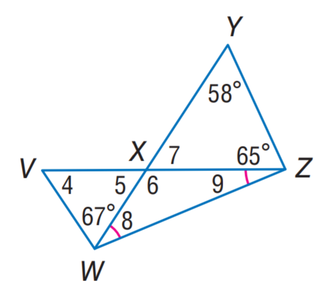

### 官方题干

Find m \angle 7.

### 官方标准答案

57

### 候选事实（逐条判断，不预设真假）

1. 角 VWY（顶点 W）的标注角度为 67度
2. 角 WYZ（顶点 Y）的标注角度为 58度
3. 角 XZY（顶点 Z）的标注角度为 65度
4. W、Z、X 与 X、W、Z 角度相等
5. 点 X 在直线（V、Z）上
6. 点 X 在直线（W、Y）上

### 对应 InterGPS 原始条件（图示）

```text
Equals(MeasureOf(Angle(Z, Y, W)), 58)
Equals(MeasureOf(Angle(Y, X, Z)), MeasureOf(angle 7))
Equals(MeasureOf(Angle(X, Z, Y)), 65)
Equals(MeasureOf(Angle(Z, V, W)), MeasureOf(angle 4))
Equals(MeasureOf(Angle(W, X, V)), MeasureOf(angle 5))
Equals(MeasureOf(Angle(Z, X, W)), MeasureOf(angle 6))
Equals(MeasureOf(Angle(X, Z, W)), MeasureOf(angle 9))
Equals(MeasureOf(Angle(X, W, Z)), MeasureOf(angle 8))
Equals(MeasureOf(Angle(X, W, Z)), MeasureOf(Angle(X, Z, W)))
Equals(MeasureOf(Angle(V, W, Y)), 67)
PointLiesOnLine(X, Line(W, Y))
PointLiesOnLine(X, Line(Z, V))
```

### 对应 InterGPS 原始条件（文字）

```text
Find(MeasureOf(Angle(7)))
```


---

## B027

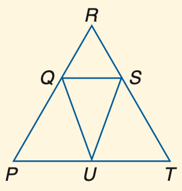

### 官方题干

If R Q \cong R S, R P \cong R T and m \angle R Q S = 80, find m \angle P.

### 官方标准答案

80

### 候选事实（逐条判断，不预设真假）

1. 点 A 在直线（R、T）上
2. 点 Q 在直线（P、R）上
3. 点 U 在直线（P、T）上

### 对应 InterGPS 原始条件（图示）

```text
PointLiesOnLine(U, Line(T, P))
PointLiesOnLine(A, Line(T, R))
PointLiesOnLine(Q, Line(R, P))
```

### 对应 InterGPS 原始条件（文字）

```text
Equals(LengthOf(Line(R,Q)),Line(R,S))
Equals(LengthOf(Line(R,P)),Line(R,T))
Equals(MeasureOf(Angle(R,Q,S)),80)
Find(MeasureOf(Angle(P)))
```


---

## B028

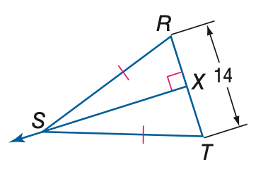

### 官方题干

Find the measure of X T.

### 官方标准答案

7

### 候选事实（逐条判断，不预设真假）

1. R、S 与 S、T 等长
2. 线段 RT 的标注长度为 14（源未指定单位）
3. R、X 与 S、X 垂直
4. 点 X 在直线（R、T）上

### 对应 InterGPS 原始条件（图示）

```text
Equals(LengthOf(Line(T, R)), 14)
PointLiesOnLine(X, Line(T, R))
Perpendicular(Line(R, X), Line(S, X))
Equals(LengthOf(Line(R, S)), LengthOf(Line(T, S)))
```

### 对应 InterGPS 原始条件（文字）

```text
Find(LengthOf(Line(X,T)))
```


---

## B029

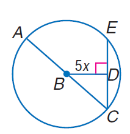

### 官方题干

In \odot B, the diameter is 20 units long, and m \angle A C E = 45. Find x.

### 官方标准答案

\sqrt { 2 }

### 候选事实（逐条判断，不预设真假）

1. 线段 BD 的标注长度为 5*x（源未指定单位）
2. B、D 与 D、E 垂直
3. 点 A 在 圆（源圆心名 B；源圆区分记号 radius_1_0，是否可见待核） 上
4. 点 C 在 圆（源圆心名 B；源圆区分记号 radius_1_0，是否可见待核） 上
5. 点 E 在 圆（源圆心名 B；源圆区分记号 radius_1_0，是否可见待核） 上
6. 点 D 在直线（C、E）上

### 对应 InterGPS 原始条件（图示）

```text
Equals(LengthOf(Line(B, D)), 5x)
PointLiesOnLine(D, Line(E, C))
PointLiesOnCircle(C, Circle(B, radius_1_0))
PointLiesOnCircle(A, Circle(B, radius_1_0))
PointLiesOnCircle(E, Circle(B, radius_1_0))
Perpendicular(Line(D, E), Line(B, D))
```

### 对应 InterGPS 原始条件（文字）

```text
Circle(B)
Equals(DiameterOf(Circle($)),2)
Equals(MeasureOf(Angle(A,C,E)),45)
Find(x)
```


---

## B030

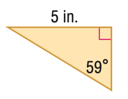

### 官方题干

Find the perimeter of the triangle. Round to the nearest hundredth.

### 官方标准答案

13.84

### 候选事实（逐条判断，不预设真假）

1. 角 ACD（顶点 C）的标注角度为 59度
2. 线段 AD 的标注长度为 5（源未指定单位）

### 对应 InterGPS 原始条件（图示）

```text
Equals(LengthOf(Line(A, D)), 5)
Equals(MeasureOf(Angle(A, C, D)), 59)
```

### 对应 InterGPS 原始条件（文字）

```text
Find(PerimeterOf(Triangle($)))
```
