# 独立图题核查：批次 3

## B031

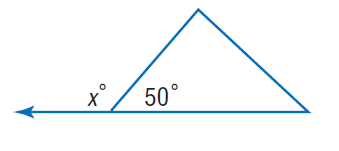

### 官方题干

Find x.

### 官方标准答案

130

### 候选事实（逐条判断，不预设真假）

1. 角 BAC（顶点 A）的标注角度为 50度
2. 角 CAD（顶点 A）的标注角度为 x度
3. 点 A 在直线（B、D）上

### 对应 InterGPS 原始条件（图示）

```text
Equals(MeasureOf(Angle(C, A, B)), 50)
Equals(MeasureOf(Angle(D, A, C)), x)
PointLiesOnLine(A, Line(B, D))
```

### 对应 InterGPS 原始条件（文字）

```text
Find(x)
```


---

## B032

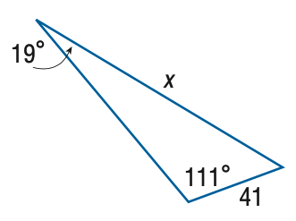

### 官方题干

Find x. Round the side measure to the nearest tenth.

### 官方标准答案

117.6

### 候选事实（逐条判断，不预设真假）

1. 角 ABC（顶点 B）的标注角度为 111度
2. 角 BAC（顶点 A）的标注角度为 19度
3. 线段 AC 的标注长度为 x（源未指定单位）
4. 线段 BC 的标注长度为 41（源未指定单位）

### 对应 InterGPS 原始条件（图示）

```text
Equals(MeasureOf(Angle(B, A, C)), 19)
Equals(LengthOf(Line(A, C)), x)
Equals(MeasureOf(Angle(A, B, C)), 111)
Equals(LengthOf(Line(B, C)), 41)
```

### 对应 InterGPS 原始条件（文字）

```text
Find(x)
```


---

## B033

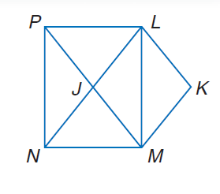

### 官方题干

Use rectangle L M N P, parallelogram L K M J to solve the problem. If m \angle P L K = 110, find m \angle L K M.

### 官方标准答案

140

### 候选事实（逐条判断，不预设真假）

1. 点 J 在直线（L、N）上
2. 点 J 在直线（M、P）上

### 对应 InterGPS 原始条件（图示）

```text
PointLiesOnLine(J, Line(M, P))
PointLiesOnLine(J, Line(L, N))
```

### 对应 InterGPS 原始条件（文字）

```text
Rectangle(L,M,N,P)
Parallelogram(L,K,M,J)
Equals(MeasureOf(Angle(P,L,K)),110)
Find(MeasureOf(Angle(L,K,M)))
```


---

## B034

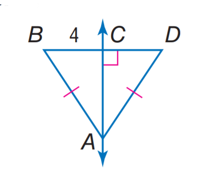

### 官方题干

Find C D.

### 官方标准答案

4

### 候选事实（逐条判断，不预设真假）

1. A、B 与 A、D 等长
2. 线段 BC 的标注长度为 4（源未指定单位）
3. A、C 与 C、D 垂直
4. 点 A 在直线（C、Y）上
5. 点 A 在直线（F、Y）上
6. 点 C 在直线（A、F）上
7. 点 C 在直线（B、D）上
8. 点 C 在直线（F、Y）上

### 对应 InterGPS 原始条件（图示）

```text
Equals(LengthOf(Line(C, B)), 4)
PointLiesOnLine(A, Line(Y, C))
PointLiesOnLine(C, Line(Y, F))
PointLiesOnLine(A, Line(Y, F))
PointLiesOnLine(C, Line(F, A))
PointLiesOnLine(C, Line(B, D))
Perpendicular(Line(C, D), Line(C, A))
Equals(LengthOf(Line(A, B)), LengthOf(Line(A, D)))
```

### 对应 InterGPS 原始条件（文字）

```text
Find(LengthOf(Line(C,D)))
```


---

## B035

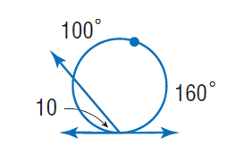

### 官方题干

Find \angle 10.

### 官方标准答案

50

### 候选事实（逐条判断，不预设真假）

1. 角 AFI（顶点 F）的标注角度为 100度
2. 角 DCI（顶点 C）的标注角度为 160度
3. 线段 AH 的标注长度为 10（源未指定单位）
4. 点 A 在 圆（源圆心名 E；源圆区分记号 radius_4_0，是否可见待核） 上
5. 点 C 在 圆（源圆心名 E；源圆区分记号 radius_4_0，是否可见待核） 上
6. 点 F 在 圆（源圆心名 E；源圆区分记号 radius_4_0，是否可见待核） 上
7. 点 A 在直线（D、H）上
8. 点 B 在直线（A、I）上
9. 点 B 在直线（C、I）上
10. 点 B 在直线（F、I）上
11. 点 C 在直线（D、G）上
12. 点 F 在直线（B、C）上
13. 点 F 在直线（C、I）上

### 对应 InterGPS 原始条件（图示）

```text
Equals(MeasureOf(Angle(I, F, A)), 100)
Equals(MeasureOf(Angle(I, C, D)), 160)
Equals(LengthOf(Line(A, H)), 10)
PointLiesOnLine(B, Line(A, I))
PointLiesOnLine(F, Line(B, C))
PointLiesOnLine(B, Line(C, I))
PointLiesOnLine(F, Line(C, I))
PointLiesOnLine(C, Line(D, G))
PointLiesOnLine(A, Line(D, H))
PointLiesOnLine(B, Line(F, I))
PointLiesOnCircle(A, Circle(E, radius_4_0))
PointLiesOnCircle(C, Circle(E, radius_4_0))
PointLiesOnCircle(F, Circle(E, radius_4_0))
```

### 对应 InterGPS 原始条件（文字）

```text
Find(MeasureOf(Angle(10)))
```


---

## B036

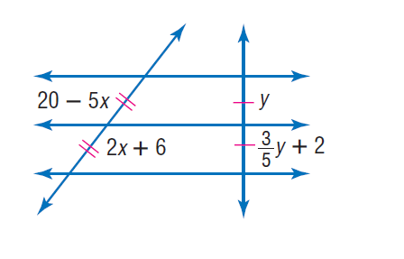

### 官方题干

Find x.

### 官方标准答案

2

### 候选事实（逐条判断，不预设真假）

1. C、Y 与 D、Y 等长
2. F、X 与 J、X 等长
3. 线段 CY 的标注长度为 y（源未指定单位）
4. 线段 DY 的标注长度为 3*y/5 + 2（源未指定单位）
5. 线段 FX 的标注长度为 20 - 5*x（源未指定单位）
6. 线段 JX 的标注长度为 2*x + 6（源未指定单位）
7. 点 C 在直线（D、G）上
8. 点 C 在直线（F、K）上
9. 点 C 在直线（G、M）上
10. 点 C 在直线（G、Y）上
11. 点 C 在直线（H、K）上
12. 点 D 在直线（C、M）上
13. 点 D 在直线（G、M）上
14. 点 D 在直线（J、L）上
15. 点 D 在直线（L、N）上
16. 点 D 在直线（M、Y）上
17. 点 F 在直线（B、I）上
18. 点 F 在直线（C、H）上
19. 点 F 在直线（H、K）上
20. 点 F 在直线（I、J）上
21. 点 F 在直线（I、X）上
22. 点 J 在直线（B、F）上
23. 点 J 在直线（B、I）上
24. 点 J 在直线（B、X）上
25. 点 J 在直线（D、N）上
26. 点 J 在直线（L、N）上
27. 点 X 在直线（A、E）上
28. 点 X 在直线（B、F）上
29. 点 X 在直线（B、I）上
30. 点 X 在直线（E、Y）上
31. 点 X 在直线（F、J）上
32. 点 X 在直线（I、J）上
33. 点 Y 在直线（A、E）上
34. 点 Y 在直线（A、X）上
35. 点 Y 在直线（C、D）上
36. 点 Y 在直线（C、M）上
37. 点 Y 在直线（D、G）上
38. 点 Y 在直线（G、M）上

### 对应 InterGPS 原始条件（图示）

```text
Equals(LengthOf(Line(X, F)), 20-5x)
Equals(LengthOf(Line(X, J)), 2x+6)
Equals(LengthOf(Line(C, Y)), y)
Equals(LengthOf(Line(D, Y)), \frac{3}{5}y+2)
Equals(LengthOf(Line(Y, C)), LengthOf(Line(Y, D)))
Equals(LengthOf(Line(X, F)), LengthOf(Line(X, J)))
PointLiesOnLine(Y, Line(X, A))
PointLiesOnLine(J, Line(X, B))
PointLiesOnLine(F, Line(X, I))
PointLiesOnLine(X, Line(A, E))
PointLiesOnLine(Y, Line(A, E))
PointLiesOnLine(X, Line(B, F))
PointLiesOnLine(J, Line(B, F))
PointLiesOnLine(X, Line(B, I))
PointLiesOnLine(F, Line(B, I))
PointLiesOnLine(J, Line(B, I))
PointLiesOnLine(X, Line(E, Y))
PointLiesOnLine(X, Line(F, J))
PointLiesOnLine(C, Line(F, K))
PointLiesOnLine(X, Line(I, J))
PointLiesOnLine(F, Line(I, J))
PointLiesOnLine(D, Line(J, L))
PointLiesOnLine(C, Line(Y, G))
PointLiesOnLine(D, Line(Y, M))
PointLiesOnLine(Y, Line(C, D))
PointLiesOnLine(F, Line(C, H))
PointLiesOnLine(D, Line(C, M))
PointLiesOnLine(Y, Line(C, M))
PointLiesOnLine(C, Line(D, G))
PointLiesOnLine(Y, Line(D, G))
PointLiesOnLine(J, Line(D, N))
PointLiesOnLine(C, Line(G, M))
PointLiesOnLine(D, Line(G, M))
PointLiesOnLine(Y, Line(G, M))
PointLiesOnLine(C, Line(H, K))
PointLiesOnLine(F, Line(H, K))
PointLiesOnLine(D, Line(L, N))
PointLiesOnLine(J, Line(L, N))
```

### 对应 InterGPS 原始条件（文字）

```text
Find(x)
```


---

## B037

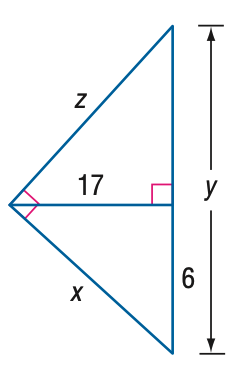

### 官方题干

Find y.

### 官方标准答案

\frac { 325 } { 6 }

### 候选事实（逐条判断，不预设真假）

1. 线段 AB 的标注长度为 z（源未指定单位）
2. 线段 AC 的标注长度为 x（源未指定单位）
3. 线段 AY 的标注长度为 17（源未指定单位）
4. 线段 BC 的标注长度为 y（源未指定单位）
5. 线段 CY 的标注长度为 6（源未指定单位）
6. A、B 与 A、C 垂直
7. A、Y 与 B、Y 垂直
8. 点 Y 在直线（B、C）上

### 对应 InterGPS 原始条件（图示）

```text
Equals(LengthOf(Line(A, B)), z)
Equals(LengthOf(Line(A, Y)), 17)
Equals(LengthOf(Line(C, Y)), 6)
Equals(LengthOf(Line(A, C)), x)
Equals(LengthOf(Line(B, C)), y)
PointLiesOnLine(Y, Line(B, C))
Perpendicular(Line(B, Y), Line(A, Y))
Perpendicular(Line(A, B), Line(A, C))
```

### 对应 InterGPS 原始条件（文字）

```text
Find(y)
```


---

## B038

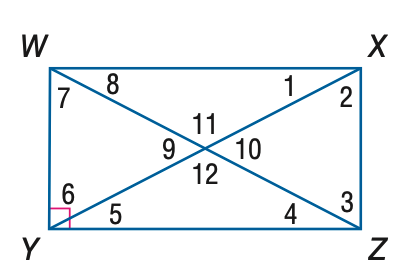

### 官方题干

Quadrilateral W X Y Z is a rectangle. Find the measure of \angle 8 if m \angle 1 = 30.

### 官方标准答案

30

### 候选事实（逐条判断，不预设真假）

1. W、Y 与 Y、Z 垂直
2. 点 A 在直线（W、Z）上
3. 点 A 在直线（X、Y）上

### 对应 InterGPS 原始条件（图示）

```text
Equals(MeasureOf(Angle(W, A, X)), MeasureOf(angle 11))
Equals(MeasureOf(Angle(A, W, Y)), MeasureOf(angle 7))
Equals(MeasureOf(Angle(W, Y, A)), MeasureOf(angle 6))
Equals(MeasureOf(Angle(X, W, Z)), MeasureOf(angle 8))
Equals(MeasureOf(Angle(X, A, Z)), MeasureOf(angle 10))
Equals(MeasureOf(Angle(Y, A, W)), MeasureOf(angle 9))
Equals(MeasureOf(Angle(W, Z, X)), MeasureOf(angle 3))
Equals(MeasureOf(Angle(A, X, W)), MeasureOf(angle 1))
Equals(MeasureOf(Angle(X, Y, Z)), MeasureOf(angle 5))
Equals(MeasureOf(Angle(Y, Z, A)), MeasureOf(angle 4))
Equals(MeasureOf(Angle(Z, A, Y)), MeasureOf(angle 12))
Equals(MeasureOf(Angle(Z, X, Y)), MeasureOf(angle 2))
PointLiesOnLine(A, Line(Z, W))
PointLiesOnLine(A, Line(Y, X))
Perpendicular(Line(Y, Z), Line(Y, W))
```

### 对应 InterGPS 原始条件（文字）

```text
Rectangle(W,X,Z,Y)
Equals(MeasureOf(Angle(1)),30)
Find(MeasureOf(Angle(8)))
```


---

## B039

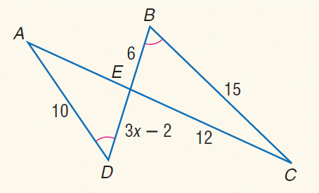

### 官方题干

Find D E.

### 官方标准答案

4

### 候选事实（逐条判断，不预设真假）

1. A、D、E 与 C、B、E 角度相等
2. 线段 AD 的标注长度为 10（源未指定单位）
3. 线段 BC 的标注长度为 15（源未指定单位）
4. 线段 BE 的标注长度为 6（源未指定单位）
5. 线段 CE 的标注长度为 12（源未指定单位）
6. 线段 DE 的标注长度为 3*x - 2（源未指定单位）
7. 点 E 在直线（A、C）上
8. 点 E 在直线（B、D）上

### 对应 InterGPS 原始条件（图示）

```text
Equals(LengthOf(Line(B, E)), 6)
Equals(LengthOf(Line(B, C)), 15)
Equals(LengthOf(Line(D, A)), 10)
Equals(LengthOf(Line(D, E)), 3x-2)
Equals(LengthOf(Line(E, C)), 12)
PointLiesOnLine(E, Line(D, B))
PointLiesOnLine(E, Line(A, C))
Equals(MeasureOf(Angle(A, D, E)), MeasureOf(Angle(C, B, E)))
```

### 对应 InterGPS 原始条件（文字）

```text
Find(LengthOf(Line(D,E)))
```


---

## B040

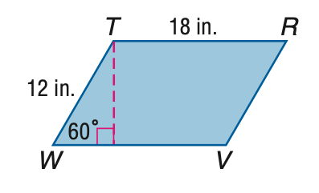

### 官方题干

Find the area of \parallelogram T R V W.

### 官方标准答案

108 \sqrt 3

### 候选事实（逐条判断，不预设真假）

1. 角 TWV（顶点 W）的标注角度为 60度
2. 线段 RT 的标注长度为 18（源未指定单位）
3. 线段 TW 的标注长度为 12（源未指定单位）
4. A、T 与 V、W 垂直
5. 点 A 在直线（V、W）上

### 对应 InterGPS 原始条件（图示）

```text
Equals(LengthOf(Line(T, R)), 18)
Equals(LengthOf(Line(W, T)), 12)
Equals(MeasureOf(Angle(T, W, V)), 60)
PointLiesOnLine(A, Line(W, V))
Perpendicular(Line(T,A), Line(W,V))
```

### 对应 InterGPS 原始条件（文字）

```text
Find(AreaOf(Parallelogram(T,R,V,W)))
```


---

## B041

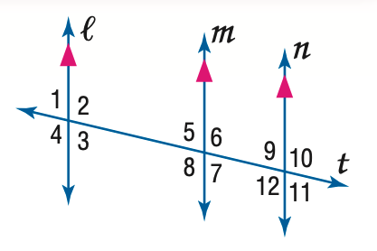

### 官方题干

In the figure, m \angle 9 = 75. Find the measure of \angle 3.

### 官方标准答案

75

### 候选事实（逐条判断，不预设真假）

1. C、E 与 D、G 平行
2. D、G 与 I、M 平行
3. 点 B 在直线（D、G）上
4. 点 B 在直线（F、L）上
5. 点 B 在直线（J、L）上
6. 点 B 在直线（L、T）上
7. 点 F 在直线（B、J）上
8. 点 F 在直线（B、T）上
9. 点 F 在直线（I、M）上
10. 点 F 在直线（J、L）上
11. 点 F 在直线（L、T）上
12. 点 J 在直线（B、T）上
13. 点 J 在直线（C、E）上
14. 点 J 在直线（F、T）上
15. 点 J 在直线（L、T）上

### 对应 InterGPS 原始条件（图示）

```text
Equals(MeasureOf(Angle(L, B, D)), MeasureOf(angle 1))
Equals(MeasureOf(Angle(D, B, F)), MeasureOf(angle 2))
Equals(MeasureOf(Angle(B, F, M)), MeasureOf(angle 5))
Equals(MeasureOf(Angle(G, B, L)), MeasureOf(angle 4))
Equals(MeasureOf(Angle(M, F, T)), MeasureOf(angle 6))
Equals(MeasureOf(Angle(J, B, G)), MeasureOf(angle 3))
Equals(MeasureOf(Angle(B, J, E)), MeasureOf(angle 9))
Equals(MeasureOf(Angle(E, J, T)), MeasureOf(angle 10))
Equals(MeasureOf(Angle(I, F, B)), MeasureOf(angle 8))
Equals(MeasureOf(Angle(J, F, I)), MeasureOf(angle 7))
Equals(MeasureOf(Angle(T, J, C)), MeasureOf(angle 11))
Equals(MeasureOf(Angle(L, J, C)), MeasureOf(angle 12))
PointLiesOnLine(J, Line(F, T))
PointLiesOnLine(B, Line(F, L))
PointLiesOnLine(F, Line(I, M))
PointLiesOnLine(F, Line(B, T))
PointLiesOnLine(J, Line(B, T))
PointLiesOnLine(F, Line(B, J))
PointLiesOnLine(B, Line(D, G))
PointLiesOnLine(B, Line(T, L))
PointLiesOnLine(F, Line(T, L))
PointLiesOnLine(J, Line(T, L))
PointLiesOnLine(B, Line(J, L))
PointLiesOnLine(F, Line(J, L))
PointLiesOnLine(J, Line(C, E))
Parallel(Line(D,G), Line(M,I))
Parallel(Line(D,G), Line(E,C))
```

### 对应 InterGPS 原始条件（文字）

```text
Equals(MeasureOf(Angle(9)),75)
Find(MeasureOf(Angle(3)))
```


---

## B042

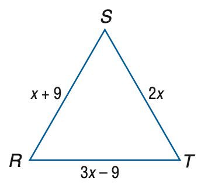

### 官方题干

Find the measure of R S of equilateral triangle R S T if R S = x + 9, S T = 2 x, and R T = 3 x - 9.

### 官方标准答案

18

### 候选事实（逐条判断，不预设真假）

1. 线段 AR 的标注长度为 x + 9（源未指定单位）
2. 线段 AT 的标注长度为 2*x（源未指定单位）

### 对应 InterGPS 原始条件（图示）

```text
Equals(LengthOf(Line(T, A)), 2x)
Equals(LengthOf(Line(R, A)), x+9)
Equals(LengthOf(Line(R, T)), 3x-9)
```

### 对应 InterGPS 原始条件（文字）

```text
Equilateral(Triangle(R,S,T))
Equals(LengthOf(Line(R,S)),x+9)
Equals(LengthOf(Line(S,T)),2x)
Equals(LengthOf(Line(R,T)),3x-9)
Find(LengthOf(Line(R,S)))
```


---

## B043

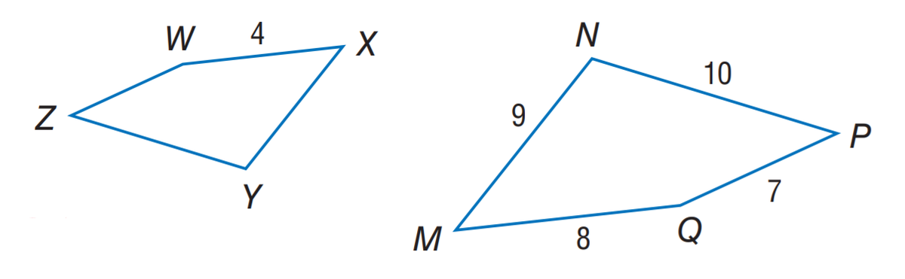

### 官方题干

If M N P Q \sim X Y Z W, find the perimeter of X Y Z W.

### 官方标准答案

17

### 候选事实（逐条判断，不预设真假）

1. 线段 MN 的标注长度为 9（源未指定单位）
2. 线段 MQ 的标注长度为 8（源未指定单位）
3. 线段 NP 的标注长度为 10（源未指定单位）
4. 线段 PQ 的标注长度为 7（源未指定单位）
5. 线段 WX 的标注长度为 4（源未指定单位）

### 对应 InterGPS 原始条件（图示）

```text
Equals(LengthOf(Line(N, P)), 10)
Equals(LengthOf(Line(W, X)), 4)
Equals(LengthOf(Line(Q, P)), 7)
Equals(LengthOf(Line(Q, M)), 8)
Equals(LengthOf(Line(N, M)), 9)
```

### 对应 InterGPS 原始条件（文字）

```text
Similar(Quadrilateral(M,N,P,Q),Quadrilateral(X,Y,Z,W))
Find(PerimeterOf(Quadrilateral(X,Y,Z,W)))
```


---

## B044

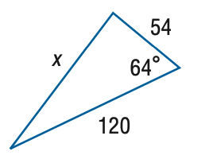

### 官方题干

Find x. Round the side measure to the nearest tenth.

### 官方标准答案

107.9

### 候选事实（逐条判断，不预设真假）

1. 角 BAC（顶点 A）的标注角度为 64度
2. 线段 AB 的标注长度为 120（源未指定单位）
3. 线段 AC 的标注长度为 54（源未指定单位）
4. 线段 BC 的标注长度为 x（源未指定单位）

### 对应 InterGPS 原始条件（图示）

```text
Equals(LengthOf(Line(A, C)), 54)
Equals(LengthOf(Line(B, C)), x)
Equals(MeasureOf(Angle(B, A, C)), 64)
Equals(LengthOf(Line(A, B)), 120)
```

### 对应 InterGPS 原始条件（文字）

```text
Find(x)
```


---

## B045

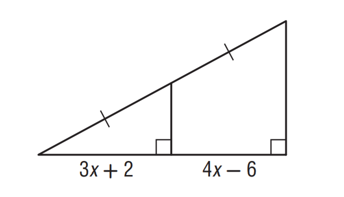

### 官方题干

Find x.

### 官方标准答案

8

### 候选事实（逐条判断，不预设真假）

1. C、E 与 D、E 等长
2. 线段 AC 的标注长度为 3*x + 2（源未指定单位）
3. 线段 AF 的标注长度为 4*x - 6（源未指定单位）
4. 点 A 在直线（C、F）上
5. 点 E 在直线（C、D）上

### 对应 InterGPS 原始条件（图示）

```text
Equals(LengthOf(Line(A, C)), 3x+2)
Equals(LengthOf(Line(A, F)), 4x-6)
Equals(LengthOf(Line(E, C)), LengthOf(Line(E, D)))
PointLiesOnLine(E, Line(C, D))
PointLiesOnLine(A, Line(C, F))
```

### 对应 InterGPS 原始条件（文字）

```text
Find(x)
```
