# 独立图题核查：批次 4

## B046

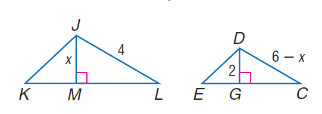

### 官方题干

Find D C if D G and J M are altitudes and \triangle K J L \sim \triangle E D C.

### 官方标准答案

4

### 候选事实（逐条判断，不预设真假）

1. 线段 CD 的标注长度为 6 - x（源未指定单位）
2. 线段 DG 的标注长度为 2（源未指定单位）
3. 线段 JL 的标注长度为 4（源未指定单位）
4. 线段 JM 的标注长度为 x（源未指定单位）
5. C、G 与 D、G 垂直
6. J、M 与 L、M 垂直
7. 点 G 在直线（C、E）上
8. 点 M 在直线（K、L）上

### 对应 InterGPS 原始条件（图示）

```text
Equals(LengthOf(Line(J, L)), 4)
Equals(LengthOf(Line(J, M)), x)
PointLiesOnLine(M, Line(L, K))
Perpendicular(Line(J, M), Line(L, M))
Equals(LengthOf(Line(D, C)), 6-x)
Equals(LengthOf(Line(D, G)), 2)
PointLiesOnLine(G, Line(E, C))
Perpendicular(Line(D, G), Line(G, C))
```

### 对应 InterGPS 原始条件（文字）

```text
IsAltitudeOf(Line(D,G),Shape($))
IsAltitudeOf(Line(J,M),Shape($))
Similar(Triangle(K,J,L),Triangle(E,D,C))
Find(LengthOf(Line(D,C)))
```


---

## B047

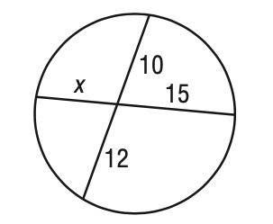

### 官方题干

Solve for x in the figure.

### 官方标准答案

8

### 候选事实（逐条判断，不预设真假）

1. 线段 AD 的标注长度为 12（源未指定单位）
2. 线段 BD 的标注长度为 10（源未指定单位）
3. 线段 CD 的标注长度为 15（源未指定单位）
4. 线段 DE 的标注长度为 x（源未指定单位）
5. 点 A 在 圆（源圆心名 F；源圆区分记号 radius_5_0，是否可见待核） 上
6. 点 B 在 圆（源圆心名 F；源圆区分记号 radius_5_0，是否可见待核） 上
7. 点 C 在 圆（源圆心名 F；源圆区分记号 radius_5_0，是否可见待核） 上
8. 点 E 在 圆（源圆心名 F；源圆区分记号 radius_5_0，是否可见待核） 上
9. 点 D 在直线（A、B）上
10. 点 D 在直线（C、E）上

### 对应 InterGPS 原始条件（图示）

```text
Equals(LengthOf(Line(B, D)), 10)
Equals(LengthOf(Line(D, E)), x)
Equals(LengthOf(Line(D, C)), 15)
Equals(LengthOf(Line(A, D)), 12)
PointLiesOnLine(D, Line(A, B))
PointLiesOnLine(D, Line(C, E))
PointLiesOnCircle(A, Circle(F, radius_5_0))
PointLiesOnCircle(B, Circle(F, radius_5_0))
PointLiesOnCircle(C, Circle(F, radius_5_0))
PointLiesOnCircle(E, Circle(F, radius_5_0))
```

### 对应 InterGPS 原始条件（文字）

```text
Find(x)
```


---

## B048

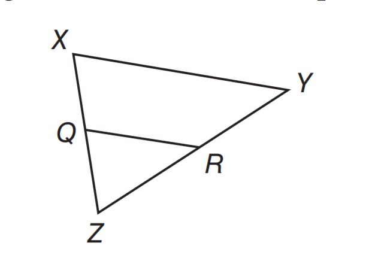

### 官方题干

If Q R \parallel X Y, X Q \cong Q Z, and Q R = 9.5 units, what is the length of X Y.

### 官方标准答案

19

### 候选事实（逐条判断，不预设真假）

1. 点 Q 在直线（X、Z）上
2. 点 R 在直线（Y、Z）上

### 对应 InterGPS 原始条件（图示）

```text
PointLiesOnLine(R, Line(Z, Y))
PointLiesOnLine(Q, Line(Z, X))
```

### 对应 InterGPS 原始条件（文字）

```text
Parallel(Line(Q,R),Line(X,Y))
Equals(LengthOf(Line(X,Q)),Line(Q,Z))
Equals(LengthOf(Line(Q,R)),9.5)
Find(LengthOf(Line(X,Y)))
```


---

## B049

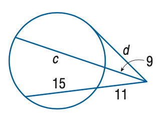

### 官方题干

Find the variable of d to the nearest tenth. Assume that segments that appear to be tangent are tangent.

### 官方标准答案

16.9

### 候选事实（逐条判断，不预设真假）

1. 线段 DF 的标注长度为 9（源未指定单位）
2. 线段 DG 的标注长度为 d（源未指定单位）
3. 线段 DH 的标注长度为 11（源未指定单位）
4. 线段 EH 的标注长度为 15（源未指定单位）
5. 点 A 在 圆（源圆心名 C；源圆区分记号 radius_5_0，是否可见待核） 上
6. 点 E 在 圆（源圆心名 C；源圆区分记号 radius_5_0，是否可见待核） 上
7. 点 F 在 圆（源圆心名 C；源圆区分记号 radius_5_0，是否可见待核） 上
8. 点 G 在 圆（源圆心名 C；源圆区分记号 radius_5_0，是否可见待核） 上
9. 点 H 在 圆（源圆心名 C；源圆区分记号 radius_5_0，是否可见待核） 上
10. 点 F 在直线（A、D）上
11. 点 H 在直线（D、E）上

### 对应 InterGPS 原始条件（图示）

```text
Equals(LengthOf(Line(D, G)), d)
Equals(LengthOf(Line(D, F)), 9)
Equals(LengthOf(Line(H, E)), 15)
Equals(LengthOf(Line(D, H)), 11)
PointLiesOnLine(F, Line(A, D))
PointLiesOnLine(H, Line(D, E))
PointLiesOnCircle(A, Circle(C, radius_5_0))
PointLiesOnCircle(E, Circle(C, radius_5_0))
PointLiesOnCircle(F, Circle(C, radius_5_0))
PointLiesOnCircle(H, Circle(C, radius_5_0))
PointLiesOnCircle(G, Circle(C, radius_5_0))
```

### 对应 InterGPS 原始条件（文字）

```text
Tangent(Line($),Circle($))
Find(d)
```


---

## B050

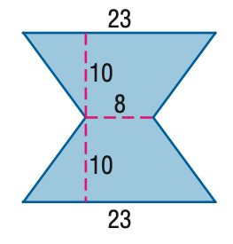

### 官方题干

Find the area of the figure. Round to the nearest tenth if necessary.

### 官方标准答案

310

### 候选事实（逐条判断，不预设真假）

1. 线段 AE 的标注长度为 23（源未指定单位）
2. 线段 BD 的标注长度为 23（源未指定单位）
3. 线段 CI 的标注长度为 8（源未指定单位）
4. 线段 FI 的标注长度为 10（源未指定单位）
5. 线段 GI 的标注长度为 10（源未指定单位）
6. A、F 与 F、I 垂直
7. D、G 与 G、I 垂直
8. 点 F 在直线（A、E）上
9. 点 G 在直线（B、D）上

### 对应 InterGPS 原始条件（图示）

```text
Equals(LengthOf(Line(A, E)), 23)
Equals(LengthOf(Line(I, F)), 10)
Equals(LengthOf(Line(I, C)), 8)
Equals(LengthOf(Line(I, G)), 10)
Equals(LengthOf(Line(B, D)), 23)
PointLiesOnLine(F, Line(A, E))
PointLiesOnLine(G, Line(B, D))
Perpendicular(Line(I, F), Line(A, F))
Perpendicular(Line(I, G), Line(D, G))
```

### 对应 InterGPS 原始条件（文字）

```text
Find(AreaOf(Shape($)))
```


---

## B051

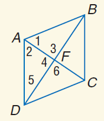

### 官方题干

Use rhombus A B C D with m \angle 1 = 2 x + 20, m \angle 2 = 5 x - 4, A C = 15, and m \angle 3 = y^ { 2 } + 26. Find x.

### 官方标准答案

8

### 候选事实（逐条判断，不预设真假）

1. 点 F 在直线（A、C）上
2. 点 F 在直线（B、D）上

### 对应 InterGPS 原始条件（图示）

```text
Equals(MeasureOf(Angle(B, A, F)), MeasureOf(angle 1))
Equals(MeasureOf(Angle(A, F, B)), MeasureOf(angle 3))
Equals(MeasureOf(Angle(C, A, D)), MeasureOf(angle 2))
Equals(MeasureOf(Angle(D, F, A)), MeasureOf(angle 4))
Equals(MeasureOf(Angle(C, F, D)), MeasureOf(angle 6))
Equals(MeasureOf(Angle(A, D, F)), MeasureOf(angle 5))
PointLiesOnLine(F, Line(A, C))
PointLiesOnLine(F, Line(D, B))
```

### 对应 InterGPS 原始条件（文字）

```text
Rhombus(A,B,C,D)
Equals(MeasureOf(Angle(1)),2x+20)
Equals(MeasureOf(Angle(2)),5x-4)
Equals(LengthOf(Line(A,C)),15)
Equals(MeasureOf(Angle(3)),y^{2}+26)
Find(x)
```


---

## B052

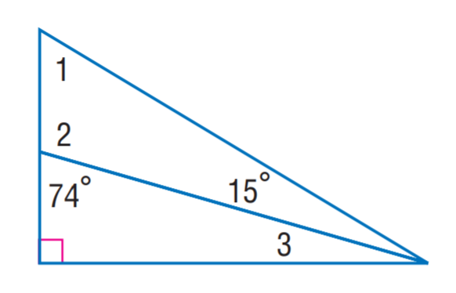

### 官方题干

Find m \angle 3.

### 官方标准答案

16

### 候选事实（逐条判断，不预设真假）

1. 角 AEC（顶点 E）的标注角度为 74度
2. 角 BAE（顶点 A）的标注角度为 15度
3. A、C 与 C、E 垂直
4. 点 E 在直线（B、C）上

### 对应 InterGPS 原始条件（图示）

```text
Equals(MeasureOf(Angle(A, B, E)), MeasureOf(angle 1))
Equals(MeasureOf(Angle(B, E, A)), MeasureOf(angle 2))
Equals(MeasureOf(Angle(E, A, B)), 15)
Equals(MeasureOf(Angle(A, E, C)), 74)
Equals(MeasureOf(Angle(C, A, E)), MeasureOf(angle 3))
PointLiesOnLine(E, Line(B, C))
Perpendicular(Line(C, E), Line(A, C))
```

### 对应 InterGPS 原始条件（文字）

```text
Find(MeasureOf(Angle(3)))
```


---

## B053

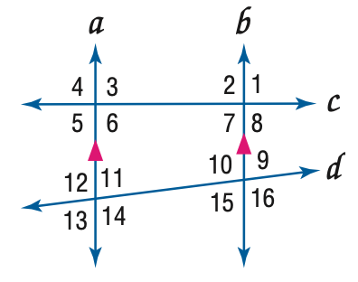

### 官方题干

In the figure, m \angle 4 = 104, m \angle 14 = 118. Find the measure of \angle 2.

### 官方标准答案

104

### 候选事实（逐条判断，不预设真假）

1. D、O 与 F、I 平行
2. 点 D 在直线（A、E）上
3. 点 D 在直线（A、O）上
4. 点 D 在直线（C、L）上
5. 点 D 在直线（I、L）上
6. 点 F 在直线（B、K）上
7. 点 F 在直线（H、J）上
8. 点 F 在直线（I、K）上
9. 点 F 在直线（J、O）上
10. 点 I 在直线（B、F）上
11. 点 I 在直线（B、K）上
12. 点 I 在直线（C、D）上
13. 点 I 在直线（C、L）上
14. 点 O 在直线（A、E）上
15. 点 O 在直线（D、E）上
16. 点 O 在直线（F、H）上
17. 点 O 在直线（H、J）上

### 对应 InterGPS 原始条件（图示）

```text
Equals(MeasureOf(Angle(B, I, C)), MeasureOf(angle 1))
Equals(MeasureOf(Angle(L, I, B)), MeasureOf(angle 2))
Equals(MeasureOf(Angle(L, D, A)), MeasureOf(angle 4))
Equals(MeasureOf(Angle(A, D, I)), MeasureOf(angle 3))
Equals(MeasureOf(Angle(O, D, L)), MeasureOf(angle 5))
Equals(MeasureOf(Angle(C, D, O)), MeasureOf(angle 6))
Equals(MeasureOf(Angle(K, I, D)), MeasureOf(angle 7))
Equals(MeasureOf(Angle(C, I, F)), MeasureOf(angle 8))
Equals(MeasureOf(Angle(B, F, J)), MeasureOf(angle 9))
Equals(MeasureOf(Angle(H, F, I)), MeasureOf(angle 10))
Equals(MeasureOf(Angle(D, O, F)), MeasureOf(angle 11))
Equals(MeasureOf(Angle(H, O, D)), MeasureOf(angle 12))
Equals(MeasureOf(Angle(J, F, K)), MeasureOf(angle 16))
Equals(MeasureOf(Angle(K, F, H)), MeasureOf(angle 15))
Equals(MeasureOf(Angle(F, O, E)), MeasureOf(angle 14))
Equals(MeasureOf(Angle(E, O, H)), MeasureOf(angle 13))
PointLiesOnLine(I, Line(D, C))
PointLiesOnLine(O, Line(D, E))
PointLiesOnLine(D, Line(C, L))
PointLiesOnLine(I, Line(C, L))
PointLiesOnLine(D, Line(E, A))
PointLiesOnLine(O, Line(E, A))
PointLiesOnLine(F, Line(I, K))
PointLiesOnLine(D, Line(I, L))
PointLiesOnLine(D, Line(A, O))
PointLiesOnLine(F, Line(O, J))
PointLiesOnLine(I, Line(F, B))
PointLiesOnLine(O, Line(F, H))
PointLiesOnLine(F, Line(B, K))
PointLiesOnLine(I, Line(B, K))
PointLiesOnLine(F, Line(H, J))
PointLiesOnLine(O, Line(H, J))
Parallel(Line(D,O), Line(I,F))
```

### 对应 InterGPS 原始条件（文字）

```text
Equals(MeasureOf(Angle(4)),104)
Equals(MeasureOf(Angle(14)),118)
Find(MeasureOf(Angle(2)))
```


---

## B054

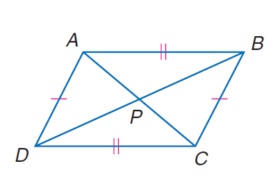

### 官方题干

In quadrilateral A B C D, A C = 188, B D = 214, m \angle B P C = 70, and P is the midpoint of A C and B D. Find the perimeter of quadrilateral A B C D.

### 官方标准答案

561.2

### 候选事实（逐条判断，不预设真假）

1. A、D 与 B、C 等长
2. 点 P 在直线（A、C）上
3. 点 P 在直线（B、D）上

### 对应 InterGPS 原始条件（图示）

```text
PointLiesOnLine(P, Line(A, C))
PointLiesOnLine(P, Line(B, D))
Equals(LengthOf(Line(A, D)), LengthOf(Line(B, C)))
```

### 对应 InterGPS 原始条件（文字）

```text
Quadrilateral(A,B,C,D)
Equals(LengthOf(Line(A,C)),188)
Equals(LengthOf(Line(B,D)),214)
Equals(MeasureOf(Angle(B,P,C)),70)
IsMidpointOf(Point(P),Line(A,C))
Line(B,D)
Find(PerimeterOf(Quadrilateral(A,B,C,D)))
```


---

## B055

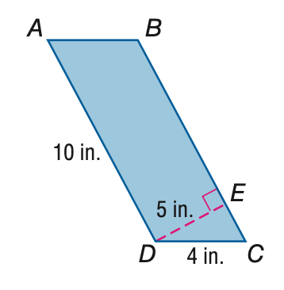

### 官方题干

Find the perimeter of \parallelogram A B C D.

### 官方标准答案

28

### 候选事实（逐条判断，不预设真假）

1. 线段 AD 的标注长度为 10（源未指定单位）
2. 线段 CD 的标注长度为 4（源未指定单位）
3. 线段 DE 的标注长度为 5（源未指定单位）
4. B、E 与 D、E 垂直
5. 点 E 在直线（B、C）上

### 对应 InterGPS 原始条件（图示）

```text
Equals(LengthOf(Line(D, C)), 4)
Equals(LengthOf(Line(D, A)), 10)
Equals(LengthOf(Line(D, E)), 5)
PointLiesOnLine(E, Line(C, B))
Perpendicular(Line(D, E), Line(B, E))
```

### 对应 InterGPS 原始条件（文字）

```text
Find(PerimeterOf(Parallelogram(A,B,C,D)))
```


---

## B056

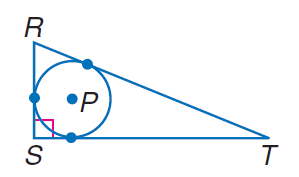

### 官方题干

Find the perimeter of the polygon for the given information. S T = 18, radius of \odot P = 5.

### 官方标准答案

58.5

### 候选事实（逐条判断，不预设真假）

1. 线段 ES 的标注长度为 5（源未指定单位）
2. E、S 与 F、S 垂直
3. 点 C 在 圆（源圆心名 D；源圆区分记号 radius_5_0，是否可见待核） 上
4. 点 E 在 圆（源圆心名 D；源圆区分记号 radius_5_0，是否可见待核） 上
5. 点 F 在 圆（源圆心名 D；源圆区分记号 radius_5_0，是否可见待核） 上
6. 点 C 在直线（R、T）上
7. 点 E 在直线（S、T）上
8. 点 F 在直线（R、S）上

### 对应 InterGPS 原始条件（图示）

```text
Equals(LengthOf(Line(C, F)), 0)
Equals(LengthOf(Line(S, E)), 5)
PointLiesOnLine(C, Line(T, R))
PointLiesOnLine(E, Line(T, S))
PointLiesOnLine(F, Line(R, S))
PointLiesOnCircle(C, Circle(D, radius_5_0))
PointLiesOnCircle(E, Circle(D, radius_5_0))
PointLiesOnCircle(F, Circle(D, radius_5_0))
Perpendicular(Line(S, F), Line(S, E))
```

### 对应 InterGPS 原始条件（文字）

```text
Equals(LengthOf(Line(S,T)),18)
Equals(RadiusOf(Circle(P)),5)
Find(PerimeterOf(Polygon($)))
```


---

## B057

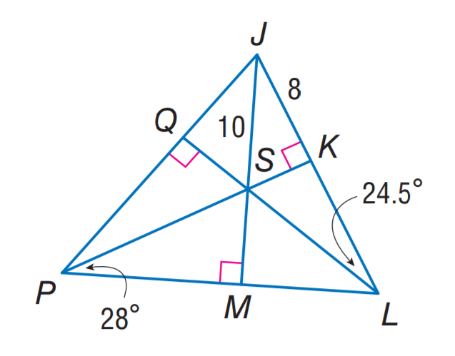

### 官方题干

Point S is the incenter of \triangle J P L. Find Q J.

### 官方标准答案

8

### 候选事实（逐条判断，不预设真假）

1. 角 KLS（顶点 L）的标注角度为 49/2度
2. 角 KPL（顶点 P）的标注角度为 28度
3. 线段 JK 的标注长度为 8（源未指定单位）
4. 线段 JS 的标注长度为 10（源未指定单位）
5. J、K 与 K、S 垂直
6. M、P 与 M、S 垂直
7. P、Q 与 Q、S 垂直
8. 点 K 在直线（J、L）上
9. 点 M 在直线（L、P）上
10. 点 Q 在直线（J、P）上
11. 点 S 在直线（J、M）上
12. 点 S 在直线（K、P）上
13. 点 S 在直线（L、Q）上

### 对应 InterGPS 原始条件（图示）

```text
Equals(LengthOf(Line(J, K)), 8)
Equals(LengthOf(Line(J, S)), 10)
Equals(MeasureOf(Angle(K, L, S)), 24.5)
Equals(MeasureOf(Angle(K, P, L)), 28)
PointLiesOnLine(K, Line(L, J))
PointLiesOnLine(M, Line(L, P))
PointLiesOnLine(S, Line(L, Q))
PointLiesOnLine(Q, Line(J, P))
PointLiesOnLine(S, Line(J, M))
PointLiesOnLine(S, Line(P, K))
Perpendicular(Line(J, K), Line(S, K))
Perpendicular(Line(S, Q), Line(P, Q))
Perpendicular(Line(S, M), Line(M, P))
```

### 对应 InterGPS 原始条件（文字）

```text
IsIncenterOf(Point(S),Triangle(J,P,L))
Find(LengthOf(Line(Q,J)))
```


---

## B058

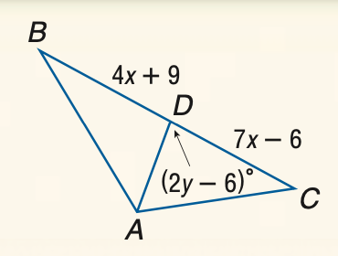

### 官方题干

Find y if A D is an altitude of \triangle A B C.

### 官方标准答案

48

### 候选事实（逐条判断，不预设真假）

1. 角 ADC（顶点 D）的标注角度为 7*x - 6度
2. 线段 BD 的标注长度为 4*x + 9（源未指定单位）
3. 线段 CD 的标注长度为 7*x - 6（源未指定单位）
4. 点 D 在直线（B、C）上

### 对应 InterGPS 原始条件（图示）

```text
Equals(LengthOf(Line(B, D)), 4x+9)
Equals(MeasureOf(Angle(A, D, C)), 7x-6)
Equals(LengthOf(Line(C, D)), 7x-6)
PointLiesOnLine(D, Line(B, C))
```

### 对应 InterGPS 原始条件（文字）

```text
Equals(Line(A,D),AltitudeOf(Triangle(A,B,C)))
Find(y)
```


---

## B059

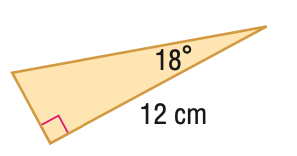

### 官方题干

Find the perimeter of the triangle. Round to the nearest hundredth.

### 官方标准答案

28.52

### 候选事实（逐条判断，不预设真假）

1. 角 CBD（顶点 B）的标注角度为 18度
2. 线段 BD 的标注长度为 12（源未指定单位）

### 对应 InterGPS 原始条件（图示）

```text
Equals(MeasureOf(Angle(D, B, C)), 18)
Equals(LengthOf(Line(D, B)), 12)
```

### 对应 InterGPS 原始条件（文字）

```text
Find(PerimeterOf(Triangle($)))
```


---

## B060

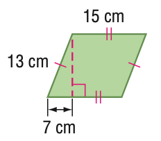

### 官方题干

Find the area of the figure. Round to the nearest tenth if necessary.

### 官方标准答案

164.3

### 候选事实（逐条判断，不预设真假）

1. A、B 与 C、O 等长
2. A、C 与 B、O 等长
3. 线段 BO 的标注长度为 15（源未指定单位）
4. 线段 CE 的标注长度为 7（源未指定单位）
5. 线段 CO 的标注长度为 13（源未指定单位）
6. A、E 与 E、O 垂直
7. 点 E 在直线（A、C）上

### 对应 InterGPS 原始条件（图示）

```text
Equals(LengthOf(Line(B, O)), 15)
Equals(LengthOf(Line(C, O)), 13)
Equals(LengthOf(Line(C,E)), 7)
Equals(LengthOf(Line(C, O)), LengthOf(Line(B, A)))
Equals(LengthOf(Line(B, O)), LengthOf(Line(C, A)))
PointLiesOnLine(E, Line(C, A))
Perpendicular(Line(O, E), Line(E, A))
```

### 对应 InterGPS 原始条件（文字）

```text
Find(AreaOf(Shape($)))
```
