# 独立图题核查：批次 5

## B061

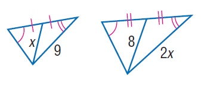

### 官方题干

Find x.

### 官方标准答案

6

### 候选事实（逐条判断，不预设真假）

1. C、A、D 与 F、E、G 角度相等
2. C、X、D 与 F、H、G 角度相等
3. A、B 与 F、H 等长
4. E、G 与 G、H 等长
5. 线段 AC 的标注长度为 2*x（源未指定单位）
6. 线段 CD 的标注长度为 8（源未指定单位）
7. 线段 EF 的标注长度为 9（源未指定单位）
8. 线段 FG 的标注长度为 x（源未指定单位）
9. 点 D 在直线（A、X）上
10. 点 G 在直线（E、H）上

### 对应 InterGPS 原始条件（图示）

```text
Equals(LengthOf(Line(C, D)), 8)
Equals(LengthOf(Line(A, C)), 2x)
Equals(LengthOf(Line(F, H)), LengthOf(Line(A, B)))
PointLiesOnLine(D, Line(A, X))
Equals(LengthOf(Line(E, F)), 9) 
Equals(LengthOf(Line(F, G)), x)
Equals(LengthOf(Line(H, G)), LengthOf(Line(G, E)))
PointLiesOnLine(G, Line(H, E))
Equals(MeasureOf(Angle(C, X, D)), MeasureOf(Angle(F, H, G)))
Equals(MeasureOf(Angle(C, A, D)), MeasureOf(Angle(F, E, G)))

```

### 对应 InterGPS 原始条件（文字）

```text
Find(x)
```


---

## B062

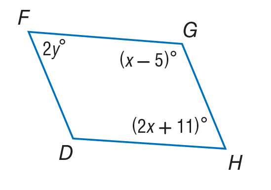

### 官方题干

Use parallelogram to find y.

### 官方标准答案

63.5

### 候选事实（逐条判断，不预设真假）

1. 角 DFG（顶点 F）的标注角度为 2*y度
2. 角 DHG（顶点 H）的标注角度为 2*x + 11度
3. 角 FGH（顶点 G）的标注角度为 x - 5度

### 对应 InterGPS 原始条件（图示）

```text
Equals(MeasureOf(Angle(G, F, D)), 2y)
Equals(MeasureOf(Angle(H, G, F)), x-5)
Equals(MeasureOf(Angle(D, H, G)), 2x+11)
```

### 对应 InterGPS 原始条件（文字）

```text
Parallelogram($)
Find(y)
```


---

## B063

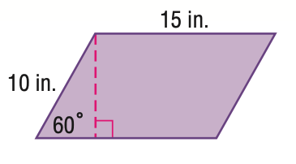

### 官方题干

Find the area of the figure. Round to the nearest tenth.

### 官方标准答案

129.9

### 候选事实（逐条判断，不预设真假）

1. 角 CED（顶点 E）的标注角度为 60度
2. 线段 AD 的标注长度为 15（源未指定单位）
3. 线段 DE 的标注长度为 10（源未指定单位）

### 对应 InterGPS 原始条件（图示）

```text
Equals(LengthOf(Line(A, D)), 15)
Equals(LengthOf(Line(D, E)), 10)
Equals(MeasureOf(Angle(D, E, C)), 60)
```

### 对应 InterGPS 原始条件（文字）

```text
Find(AreaOf(Shape($)))
```


---

## B064

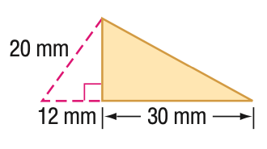

### 官方题干

Find the area of the triangle. Round to the nearest tenth if necessary.

### 官方标准答案

240

### 候选事实（逐条判断，不预设真假）

1. 线段 AC 的标注长度为 20（源未指定单位）
2. 线段 BM 的标注长度为 30（源未指定单位）
3. 线段 CM 的标注长度为 12（源未指定单位）
4. A、M 与 C、M 垂直
5. 点 M 在直线（B、C）上

### 对应 InterGPS 原始条件（图示）

```text
Equals(LengthOf(Line(A, C)), 20)
Equals(LengthOf(Line(B, M)), 30)
Equals(LengthOf(Line(C, M)), 12)
PointLiesOnLine(M, Line(C, B))
Perpendicular(Line(A, M), Line(M, C))
```

### 对应 InterGPS 原始条件（文字）

```text
Find(AreaOf(Triangle($)))
```


---

## B065

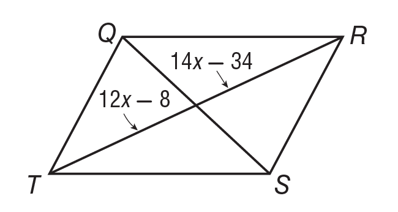

### 官方题干

If Q R S T is a parallelogram, what is the value of x?

### 官方标准答案

13

### 候选事实（逐条判断，不预设真假）

1. 线段 AR 的标注长度为 12*x - 8（源未指定单位）
2. 线段 AT 的标注长度为 14*x - 34（源未指定单位）
3. 点 A 在直线（Q、S）上
4. 点 A 在直线（R、T）上

### 对应 InterGPS 原始条件（图示）

```text
Equals(LengthOf(Line(T, A)), 14x-34)
Equals(LengthOf(Line(R, A)), 12x-8)
PointLiesOnLine(A, Line(Q, S))
PointLiesOnLine(A, Line(R, T))
```

### 对应 InterGPS 原始条件（文字）

```text
Parallelogram(Q,R,S,T)
Find(x)
```


---

## B066

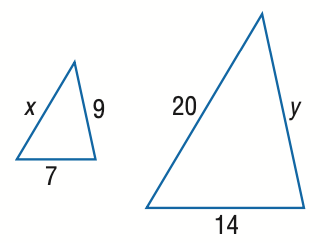

### 官方题干

Find y.

### 官方标准答案

18

### 候选事实（逐条判断，不预设真假）

1. 线段 AB 的标注长度为 y（源未指定单位）
2. 线段 AX 的标注长度为 20（源未指定单位）
3. 线段 BX 的标注长度为 14（源未指定单位）
4. 线段 CD 的标注长度为 9（源未指定单位）
5. 线段 CE 的标注长度为 x（源未指定单位）
6. 线段 DE 的标注长度为 7（源未指定单位）

### 对应 InterGPS 原始条件（图示）

```text
Equals(LengthOf(Line(C, D)), 9)
Equals(LengthOf(Line(C, E)), x)
Equals(LengthOf(Line(D, E)), 7)
Equals(LengthOf(Line(X, A)), 20)
Equals(LengthOf(Line(A, B)), y)
Equals(LengthOf(Line(X, B)), 14)
```

### 对应 InterGPS 原始条件（文字）

```text
Find(y)
```


---

## B067

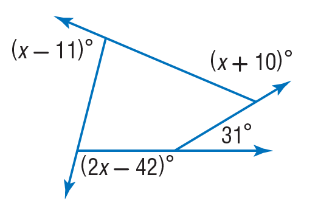

### 官方题干

Find the value of x in the diagram.

### 官方标准答案

93

### 候选事实（逐条判断，不预设真假）

1. 角 ABE（顶点 B）的标注角度为 x + 10度
2. 角 BDG（顶点 D）的标注角度为 31度
3. 角 CAF（顶点 A）的标注角度为 x - 11度
4. 角 GCH（顶点 C）的标注角度为 2*x - 42度
5. 点 A 在直线（B、F）上
6. 点 B 在直线（D、E）上
7. 点 C 在直线（A、H）上
8. 点 D 在直线（C、G）上

### 对应 InterGPS 原始条件（图示）

```text
Equals(MeasureOf(Angle(C, A, F)), x-11)
Equals(MeasureOf(Angle(A, B, E)), x+10)
Equals(MeasureOf(Angle(B, D, G)), 31)
Equals(MeasureOf(Angle(G, C, H)), 2x-42)
PointLiesOnLine(C, Line(A, H))
PointLiesOnLine(A, Line(B, F))
PointLiesOnLine(B, Line(D, E))
PointLiesOnLine(D, Line(C, G))
```

### 对应 InterGPS 原始条件（文字）

```text
Find(x)
```


---

## B068

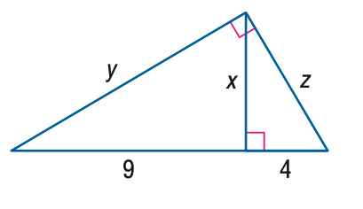

### 官方题干

Find x.

### 官方标准答案

6

### 候选事实（逐条判断，不预设真假）

1. 线段 AB 的标注长度为 y（源未指定单位）
2. 线段 AD 的标注长度为 9（源未指定单位）
3. 线段 BC 的标注长度为 z（源未指定单位）
4. 线段 BD 的标注长度为 x（源未指定单位）
5. 线段 CD 的标注长度为 4（源未指定单位）
6. A、B 与 B、C 垂直
7. B、D 与 C、D 垂直
8. 点 D 在直线（A、C）上

### 对应 InterGPS 原始条件（图示）

```text
Equals(LengthOf(Line(A, B)), y)
Equals(LengthOf(Line(B, C)), z)
Equals(LengthOf(Line(B, D)), x)
Equals(LengthOf(Line(A, D)), 9)
Equals(LengthOf(Line(C, D)), 4)
PointLiesOnLine(D, Line(A, C))
Perpendicular(Line(A, B), Line(B, C))
Perpendicular(Line(B, D), Line(C, D))
```

### 对应 InterGPS 原始条件（文字）

```text
Find(x)
```


---

## B069

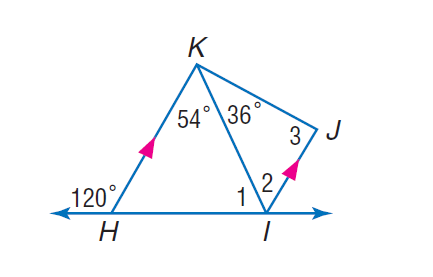

### 官方题干

If K H is parallel to J I, find the measure of \angle 2.

### 官方标准答案

54

### 候选事实（逐条判断，不预设真假）

1. 角 CKH（顶点 K）的标注角度为 54度
2. 角 DCF（顶点 C）的标注角度为 120度
3. 角 HKJ（顶点 K）的标注角度为 36度
4. 点 A 在直线（C、K）上
5. 点 A 在直线（F、K）上
6. 点 A 在直线（I、K）上
7. 点 B 在直线（G、H）上
8. 点 C 在直线（D、E）上
9. 点 C 在直线（D、H）上
10. 点 F 在直线（A、C）上
11. 点 F 在直线（C、I）上
12. 点 F 在直线（C、K）上
13. 点 G 在直线（B、J）上
14. 点 G 在直线（B、L）上
15. 点 G 在直线（H、J）上
16. 点 G 在直线（H、L）上
17. 点 H 在直线（C、E）上
18. 点 H 在直线（D、E）上
19. 点 I 在直线（A、C）上
20. 点 I 在直线（A、F）上
21. 点 I 在直线（C、K）上
22. 点 I 在直线（F、K）上
23. 点 L 在直线（B、J）上
24. 点 L 在直线（G、J）上
25. 点 L 在直线（H、J）上

### 对应 InterGPS 原始条件（图示）

```text
Equals(MeasureOf(Angle(J, K, H)), 36)
Equals(MeasureOf(Angle(H, K, C)), 54)
Equals(MeasureOf(Angle(L, J, K)), MeasureOf(angle 3))
Equals(MeasureOf(Angle(K, H, L)), MeasureOf(angle 2))
Equals(MeasureOf(Angle(D, H, K)), MeasureOf(angle 1))
Equals(MeasureOf(Angle(D, C, F)), 120)
PointLiesOnLine(F, Line(A, C))
PointLiesOnLine(I, Line(A, C))
PointLiesOnLine(I, Line(A, F))
PointLiesOnLine(A, Line(C, K))
PointLiesOnLine(F, Line(C, K))
PointLiesOnLine(I, Line(C, K))
PointLiesOnLine(H, Line(C, E))
PointLiesOnLine(F, Line(C, I))
PointLiesOnLine(A, Line(K, F))
PointLiesOnLine(I, Line(K, F))
PointLiesOnLine(A, Line(K, I))
PointLiesOnLine(G, Line(B, J))
PointLiesOnLine(L, Line(B, J))
PointLiesOnLine(G, Line(B, L))
PointLiesOnLine(G, Line(J, H))
PointLiesOnLine(L, Line(J, H))
PointLiesOnLine(L, Line(J, G))
PointLiesOnLine(C, Line(H, D))
PointLiesOnLine(B, Line(H, G))
PointLiesOnLine(G, Line(H, L))
PointLiesOnLine(C, Line(D, E))
PointLiesOnLine(H, Line(D, E))
```

### 对应 InterGPS 原始条件（文字）

```text
Parallel(Line(K,H),Line(J,I))
Find(MeasureOf(Angle(2)))
```


---

## B070

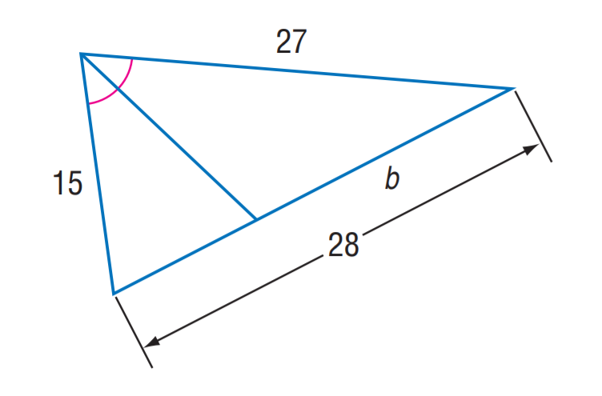

### 官方题干

Find b.

### 官方标准答案

18

### 候选事实（逐条判断，不预设真假）

1. A、D、B 与 A、D、C 角度相等
2. 线段 AC 的标注长度为 b（源未指定单位）
3. 线段 BC 的标注长度为 28（源未指定单位）
4. 线段 BD 的标注长度为 15（源未指定单位）
5. 线段 CD 的标注长度为 27（源未指定单位）
6. 点 A 在直线（B、C）上

### 对应 InterGPS 原始条件（图示）

```text
Equals(LengthOf(Line(C, D)), 27)
Equals(LengthOf(Line(C, A)), b)
Equals(LengthOf(Line(B, D)), 15)
Equals(LengthOf(Line(C, B)), 28)
PointLiesOnLine(A, Line(B, C))
Equals(MeasureOf(Angle(B, D, A)), MeasureOf(Angle(A, D, C)))
```

### 对应 InterGPS 原始条件（文字）

```text
Find(b)
```


---

## B071

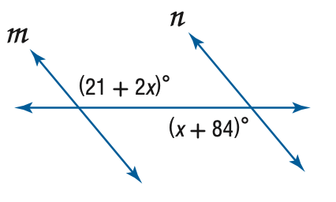

### 官方题干

Find x so that m \parallel n.

### 官方标准答案

63

### 候选事实（逐条判断，不预设真假）

1. 角 AFB（顶点 F）的标注角度为 x + 84度
2. 角 DAT（顶点 A）的标注角度为 2*x + 21度
3. 点 A 在直线（C、T）上
4. 点 A 在直线（D、E）上
5. 点 A 在直线（E、F）上
6. 点 F 在直线（A、D）上
7. 点 F 在直线（B、N）上
8. 点 F 在直线（D、E）上

### 对应 InterGPS 原始条件（图示）

```text
Equals(MeasureOf(Angle(T, A, D)), 21+2x)
Equals(MeasureOf(Angle(B, F, A)), x+84)
PointLiesOnLine(F, Line(N, B))
PointLiesOnLine(A, Line(F, E))
PointLiesOnLine(F, Line(A, D))
PointLiesOnLine(A, Line(C, T))
PointLiesOnLine(A, Line(D, E))
PointLiesOnLine(F, Line(D, E))
```

### 对应 InterGPS 原始条件（文字）

```text
Parallel(Line(m),Line(n))
Find(x)
```


---

## B072

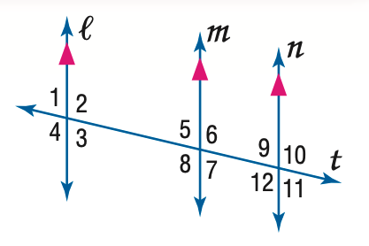

### 官方题干

In the figure, m \angle 9 = 75. Find the measure of \angle 12.

### 官方标准答案

105

### 候选事实（逐条判断，不预设真假）

1. C、E 与 D、G 平行
2. D、G 与 I、M 平行
3. 点 B 在直线（D、G）上
4. 点 B 在直线（F、L）上
5. 点 B 在直线（J、L）上
6. 点 B 在直线（L、T）上
7. 点 F 在直线（B、J）上
8. 点 F 在直线（B、T）上
9. 点 F 在直线（I、M）上
10. 点 F 在直线（J、L）上
11. 点 F 在直线（L、T）上
12. 点 J 在直线（B、T）上
13. 点 J 在直线（C、E）上
14. 点 J 在直线（F、T）上
15. 点 J 在直线（L、T）上

### 对应 InterGPS 原始条件（图示）

```text
Equals(MeasureOf(Angle(L, B, D)), MeasureOf(angle 1))
Equals(MeasureOf(Angle(D, B, F)), MeasureOf(angle 2))
Equals(MeasureOf(Angle(B, F, M)), MeasureOf(angle 5))
Equals(MeasureOf(Angle(G, B, L)), MeasureOf(angle 4))
Equals(MeasureOf(Angle(M, F, T)), MeasureOf(angle 6))
Equals(MeasureOf(Angle(J, B, G)), MeasureOf(angle 3))
Equals(MeasureOf(Angle(B, J, E)), MeasureOf(angle 9))
Equals(MeasureOf(Angle(E, J, T)), MeasureOf(angle 10))
Equals(MeasureOf(Angle(I, F, B)), MeasureOf(angle 8))
Equals(MeasureOf(Angle(J, F, I)), MeasureOf(angle 7))
Equals(MeasureOf(Angle(T, J, C)), MeasureOf(angle 11))
Equals(MeasureOf(Angle(L, J, C)), MeasureOf(angle 12))
PointLiesOnLine(J, Line(F, T))
PointLiesOnLine(B, Line(F, L))
PointLiesOnLine(F, Line(I, M))
PointLiesOnLine(F, Line(B, T))
PointLiesOnLine(J, Line(B, T))
PointLiesOnLine(F, Line(B, J))
PointLiesOnLine(B, Line(D, G))
PointLiesOnLine(B, Line(T, L))
PointLiesOnLine(F, Line(T, L))
PointLiesOnLine(J, Line(T, L))
PointLiesOnLine(B, Line(J, L))
PointLiesOnLine(F, Line(J, L))
PointLiesOnLine(J, Line(C, E))
Parallel(Line(D,G), Line(M,I))
Parallel(Line(D,G), Line(E,C))
```

### 对应 InterGPS 原始条件（文字）

```text
Equals(MeasureOf(Angle(9)),75)
Find(MeasureOf(Angle(12)))
```


---

## B073

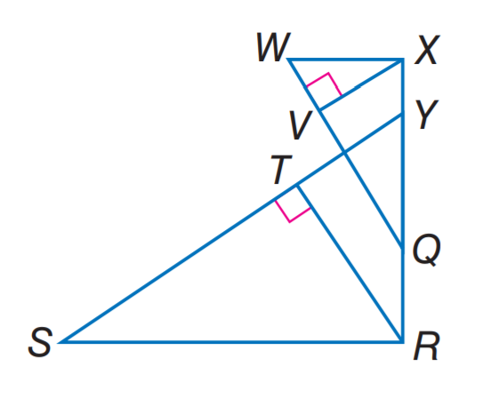

### 官方题干

If \triangle S R Y \sim \triangle W X Q, R T is an altitude of \triangle S R Y, X V is an altitude of \triangle W X Q, R T = 5, R Q = 4, Q Y = 6, and Y X = 2, find X V.

### 官方标准答案

4

### 候选事实（逐条判断，不预设真假）

1. R、T 与 S、T 垂直
2. V、W 与 V、X 垂直
3. 点 A 在直线（Q、V）上
4. 点 A 在直线（Q、W）上
5. 点 A 在直线（S、Y）上
6. 点 A 在直线（T、Y）上
7. 点 Q 在直线（R、X）上
8. 点 Q 在直线（R、Y）上
9. 点 T 在直线（A、S）上
10. 点 T 在直线（S、Y）上
11. 点 V 在直线（A、W）上
12. 点 V 在直线（Q、W）上
13. 点 Y 在直线（Q、X）上
14. 点 Y 在直线（R、X）上

### 对应 InterGPS 原始条件（图示）

```text
PointLiesOnLine(T, Line(S, Y))
PointLiesOnLine(A, Line(S, Y))
PointLiesOnLine(T, Line(S, A))
PointLiesOnLine(Q, Line(Y, R))
PointLiesOnLine(A, Line(Y, T))
PointLiesOnLine(Y, Line(R, X))
PointLiesOnLine(Q, Line(R, X))
PointLiesOnLine(V, Line(A, W))
PointLiesOnLine(A, Line(Q, V))
PointLiesOnLine(Y, Line(Q, X))
PointLiesOnLine(V, Line(Q, W))
PointLiesOnLine(A, Line(Q, W))
Perpendicular(Line(V, W), Line(X, V))
Perpendicular(Line(S, T), Line(R, T))
```

### 对应 InterGPS 原始条件（文字）

```text
Similar(Triangle(S,R,Y),Triangle(W,X,Q))
Equals(Line(R,T),AltitudeOf(Triangle(S,R,Y)))
Equals(Line(X,V),AltitudeOf(Triangle(W,X,Q)))
Equals(LengthOf(Line(R,T)),5)
Equals(LengthOf(Line(R,Q)),4)
Equals(LengthOf(Line(Q,Y)),6)
Equals(LengthOf(Line(Y,X)),2)
Find(LengthOf(Line(X,V)))
```


---

## B074

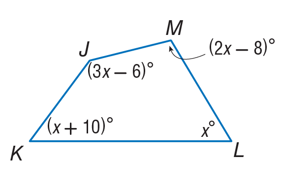

### 官方题干

Find m \angle M.

### 官方标准答案

96

### 候选事实（逐条判断，不预设真假）

1. 角 JKL（顶点 K）的标注角度为 x + 10度
2. 角 JML（顶点 M）的标注角度为 2*x - 8度
3. 角 KJM（顶点 J）的标注角度为 3*x - 6度
4. 角 KLM（顶点 L）的标注角度为 x度

### 对应 InterGPS 原始条件（图示）

```text
Equals(MeasureOf(Angle(J, M, L)), 2x-8)
Equals(MeasureOf(Angle(M, J, K)), 3x-6)
Equals(MeasureOf(Angle(J, K, L)), x+10)
Equals(MeasureOf(Angle(K, L, M)), x)
```

### 对应 InterGPS 原始条件（文字）

```text
Find(MeasureOf(Angle(M)))
```


---

## B075

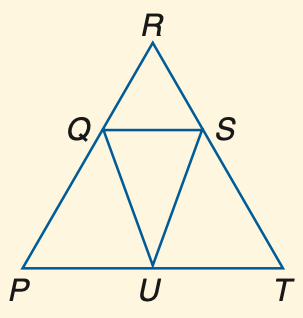

### 官方题干

If P Q \cong U Q, P R \cong R T and m \angle P Q U = 40, find m \angle R.

### 官方标准答案

40

### 候选事实（逐条判断，不预设真假）

1. 点 A 在直线（R、T）上
2. 点 Q 在直线（P、R）上
3. 点 U 在直线（P、T）上

### 对应 InterGPS 原始条件（图示）

```text
PointLiesOnLine(U, Line(T, P))
PointLiesOnLine(A, Line(T, R))
PointLiesOnLine(Q, Line(R, P))
```

### 对应 InterGPS 原始条件（文字）

```text
Equals(LengthOf(Line(P,Q)),Line(U,Q))
Equals(LengthOf(Line(P,R)),Line(R,T))
Equals(MeasureOf(Angle(P,Q,U)),40)
Find(MeasureOf(Angle(R)))
```
