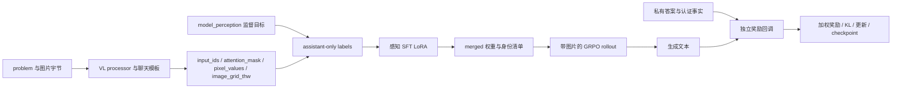

# 多模态几何推理：接手核查 v1

日期：2026-10-24。工作根目录：`D:\Users\Mr.Z\Desktop\项目三_多模态几何推理`。

本轮结论：当前可确认的是**部分认证感知数据及离线工程入口**，不能确认几何解题能力提升、视觉感知改善或完整 V0～V4 实验成功。本轮没有下载模型、调用付费视觉 API、启动 GPU 训练、扩充标签或改变批准/划分。既有源码、配置、发布、审核、图片及 migration manifest 均未修改；只新增本目录的接手记录、可复核脚本及日志。

## 1. 当前问题与实现边界

研究需要分别回答：模型是否使用图像；使用的视觉事实是否正确；这些事实是否改善解题。答案正确、图像扰动后答案变化、认证范围内事实得分，是三个不同观测，不能相互替代。

主模型固定为 `Qwen/Qwen2.5-VL-3B-Instruct`，revision `66285546d2b821cf421d4f5eb2576359d3770cd3`。当前两份根配置均为 `vision=true`、2 步 smoke，SFT 只监督 `model_perception`；稀疏 RL 的模型路径是该 SFT 导出的 merged 基座。实际后端为 HF Transformers/TRL。证据：`configs/project3_fact_sft_smoke.json:1`、`configs/project3_sparse_v4_grpo_smoke.json:1`；`scripts/train_project3.py:1–2`；`src/training/approved_hf.py:90–157`。

详细方案中 V0 是原始 VL；V1 是答案 SFT；V2 是感知事实加答案 SFT；V3/V4 均从 V0 开始，V4 只多感知奖励。当前感知 SFT 不是 V2，当前 SFT→RL 不是正式 V3/V4。方案中的 EasyR1、统一三段输出、独立格式奖励、正式预算也没有被当前 smoke 全部实现。证据：`project_blueprints/项目三_多模态几何推理_详细实施方案.md:93–145`。

旧方案前部的 26、531 和“当前只审核”等段落，以及旧报告的旧绝对配置路径是历史材料；本轮按 portable manifest 和实际源码核验，没有覆盖这些历史证据。当前核验仍为 609/82，未发现后续替换该批准范围的内容。

## 2. 环境与实际命令

默认 `python` 是 `D:\anaconda3\python.exe`，Python 3.8.3。按要求执行 `python tools/verify_migration.py`，失败于 `approved_training_inputs.py:11` 的 `Path.is_relative_to`，这是 Python 版本缺口，不能据此判断数据损坏。`py -0p` 列出了 C 盘 Python311，但 `py -3.11` 实际启动失败；本机另有可用的 `D:\Python\Python311\python.exe`（3.11.4）。没有修改 PATH，也没有使用其他项目的虚拟环境。

D 盘解释器的当前主要包：torch 2.7.1、transformers 4.53.1、datasets 3.6.0、accelerate 1.8.1、pytest 8.3.5、sympy 1.14.0、Pillow 11.2.1、pyarrow 20.0.0；**TRL、PEFT 缺失**。完整分布版本见 [environment.json](environment.json)。它不是 README 的历史 CPU 快照环境，不能称为已复原的训练环境。Codex 附带 Python 3.12.14 另经检查，缺 pytest/torch/transformers/trl/peft 等，只适合本轮标准库/图片检查，不向其中安装训练依赖。

本轮可复核的命令和结果：

```powershell
& D:\Python\Python311\python.exe tools/verify_migration.py
& D:\Python\Python311\python.exe tools/verify_migration.py --full
& D:\Python\Python311\python.exe reports/handover_audit_20261024_v1/audit_offline.py
& D:\Python\Python311\python.exe reports/handover_audit_20261024_v1/reward_probes.py
```

- 普通迁移校验：4258 个清单文件，609/82 行，errors=[]，退出 0。见 [verify_migration.log](verify_migration.log)。
- `--full`：4258 个原清单文件的 SHA 全部通过，errors=[]，退出 0。见 [verify_migration_full.log](verify_migration_full.log)。新增接手文件不在旧迁移负载清单内，未重算旧清单来“批准”任何新数据。
- README 指定四文件测试：**14 passed / 1 failed**；失败为 `test_actual_trl_group_policy_cpu` 导入 `trl` 失败。保存的一次复核耗时 27.93 秒。见 [readme_tests.log](readme_tests.log)。本轮前一次同命令也为 14/1，未作为两次独立有效性证据相加。
- 数据/解析/像素守卫补充回归：**39 passed，2.16 秒**。与上组有重叠，不能相加为 53 个独立测试。见 [data_tests.log](data_tests.log)、[commands.json](commands.json)。
- 原 README 组中小 GPT2 的 SFT 优化器/checkpoint 恢复和数学答案回调均通过；这不是 VL checkpoint 或视觉 GRPO 通过。OPD 测试是共享文件附带测试，不构成本项目视觉能力证据。

运行审计脚本时设置 `HF_HUB_OFFLINE=1`、`TRANSFORMERS_OFFLINE=1`、`PYTEST_DISABLE_PLUGIN_AUTOLOAD=1`；没有网络模型下载。全量 GPU 模型、实际 processor 展开、前后向、显存、视觉 rollout、参考策略 KL、完整恢复均未执行。

缺依赖的隔离准备步骤见 [下一阶段最小工作单](下一阶段最小工作单.md)。不为凑历史 15 passed 修改测试或向共享环境安装缺包。

## 3. 发布身份、图片与 split 核验

准入入口是 `data/portable_release/manifest.json:34–46` 的两个文件列表和文件 SHA，跨项目 summary 不授予额外训练权。`load_approved` 只接受训练列表、限制路径不逃逸 release、校验 SHA、要求逐行批准和唯一 ID（`src/data/approved_training_inputs.py:6–17`）。validation 不通过该训练入口。

本轮逐行独立比较迁移来源与 portable 运行副本，保持行序：691 行除 `image_path` 外完全相同，原来源文件与 portable 文件 SHA 均匹配迁移记录。没有改变题目、答案、事实、审核、批准、ID 或 split。还按**原始压缩包里的 img_diagram.png 字节**逐文件比较运行图片，691 个图片路径全部字节一致；这比只比较记录里的 SHA 更直接。

重新按 RGB 解码与尺寸计算像素身份，公式为 `SHA256(str(image.size).encode() + b'\0' + image.tobytes())`，与现存关联表、官方原图记录、逐行 SHA 全部一致（原方法见 `src/data/project3_audit.py:32–34`）。这里的 691 是图片文件路径数，不是独立图像数。

- train：609 个唯一 sample_id、609 个唯一 original_id、458 个不同像素图；2799 条认证正事实，0 条负事实。
- validation：82 个唯一 sample_id、82 个唯一 original_id、77 个不同像素图；363 条认证正事实，0 条负事实。
- train/validation 像素集合交集为空；训练 sample_id 与 protected dev ID 无交集。
- 用全部关联表重新执行 guard：train 609、validation 82 全部保留。guard 的优先级为 test > validation > train；训练排除全部官方 validation/test 图像身份，validation 排除 test 图像身份。不是只看最终 82 个 validation（`src/data/geometry_split_guard.py:2–17`）。

机器证据：[data_checks.json](data_checks.json)；执行逻辑：[audit_offline.py](audit_offline.py)。本轮不重建全量 parquet 来源关联，也没有检验所有非精确重压缩/裁剪图像；当前发布路径与已存官方关联的身份一致，不等于近重复全部排除。

历史数量的路径清楚：事实质量筛选先得到 928/123；随后像素守卫排除 319/41，得到 609/82。证据：`data/strict_v8_20261024/geometry/summary.json`、`reports/strict_v8_20261024/执行报告.md:21–29`。不能用 2396 个收到响应、2054/293 个结构有效审核或 928 个质量通过行冒充最终训练批准数。

## 4. 真实图片、认证事实与一条输出如何流动

示例是 `data/portable_release/project3_train_fact_pruned.jsonl:1`：sample_id=`train:10`，original_id=`1670`，问题=`<image>Find x`，私有答案=`4`。关联证据为 `data/project3_audit/geometry3k_intergps_links.jsonl:11`；官方原记录为 `data/project3_audit/intergps_annotations.jsonl:748`；压缩包定位为 `train.zip::train/1670/img_diagram.png`。逐项审核、官方逻辑式和图片身份汇入 [sample_trace.json](sample_trace.json)，没有修改原审核。


图片字节 SHA：`61af8d6da15b8e1f39a936e8a3f02da926dbf946c76043ec262b4264a17f9560`；像素 SHA：`983a9aa06399a34db78ec275e15c54587a899c89607d28c6db6beb25a0b596cd`。

本轮实际查看原图，可以看到 AC 旁的 1、CD 旁的 6、BC 旁的 x+3 和 CE 旁的 11x−2。记录中的事实 `Length(A,C)=1` 附有证据 `Printed '1' labels segment AC.`。这条事实的进入路径为官方候选 → 审核 certified → 可见点名守卫/文字排除 → `certified_positive_tokens` → `model_perception`。这仍是委托 AI 加规则的认证历史，本轮单图查看不能升级为全量人工金标。

原图还有 AB/DE 上的平行箭头，但该样本发布的六条正事实**没有 Parallel**。官方这条候选列表也没有该关系。本轮没有补标。若预测 `Parallel((A,B),(D,E))`，当前评分将其 mask；不能因不在金标列表就惩罚为错误，也不能把这个事实纳入当前 Recall 分母。

作为读图解释，若使用原图平行箭头和交点关系，可得三角形 ACB 与 DCE 相似，`AC/CD = BC/CE`，即 `1/6 = (x+3)/(11x−2)`，从而 `11x−2=6x+18`、`x=4`。这是本轮对单图的解释，不是模型推理实测，也没有写回认证列表。它同时表明：六条部分事实本身没有编码全部求解条件，不能要求部分事实得分代表完整解题条件恢复。



### 4.1 输入与 SFT

`model_view(...,'perception_sft')` 返回的 input 只有 problem/image_path，target 只有 model_perception（`approved_training_inputs.py:28–33`）。SFT dataset 仍携带 SHA、批准和白名单等校验字段，但 collator 只把图片、题面和 target 交给 processor，不会把其他字段直接串入文本（`approved_hf.py:59–65,122–125`）。因此“保存在 dataset 列中”与“进入模型 tokens”要区别。

`VisualCompletionCollator` 读取原图并转 RGB，删除题面开头的 `<image>`，构造一个 image 内容块和一个问题文本块；再用同一 processor 渲染 prefix 与含 assistant 的完整消息。`AutoProcessor` 负责图像缩放、patch/视觉输入张量、图像占位展开及模板联动；其内部 tokenizer 负责文本 token ID。tokenizer 不是视觉编码器，pixel_values 后续由模型视觉模块变为视觉表示，模型再与文本嵌入融合。配置保留 `Qwen2.5-7B-Instruct` 的 tokenizer_path **不意味着视觉分支使用该文本 tokenizer**：vision 分支明确从固定 VL 模型加载 AutoProcessor，只有非 vision 分支才走 AutoTokenizer（`approved_hf.py:108–113`）。

labels 先复制 input_ids，padding 设 −100；再用同图 prefix 的长度把整个 user/图像/prompt 区设为 −100。只保留 assistant 目标及模板结束 token 的损失监督。文本 prompt 长度不是最终多模态序列长度，实际长度必须等 processor 处理图片后测。prefix 不匹配或总长度大于 3800 会抛错，没有请求静默 truncation（`approved_hf.py:65–72`）。这是代码保护，真实模型图像 token 与 padding mask 仍待验收。

注意：SFT 的 assistant 仅输出 `<perception>…</perception>`，没有答案 4 或解题过程。它没有学习“输出完整几何解答”这个监督目标。私有参考答案没有被当作模型输入。

### 4.2 参数、合并与 rollout

PEFT LoRA 配置 rank 默认 16、alpha 32，目标后缀为 q_proj/k_proj/v_proj/o_proj/gate_proj/up_proj/down_proj；未明确列出视觉模块冻结断言，也未导出实际 trainable parameter 名单（`approved_hf.py:114–120`）。按 PEFT 通常行为是冻结底座并训练注入的 adapter，但本轮不能从后缀列表推定实际模型的视觉模块一定不命中。是否只训练语言 LoRA、视觉 encoder/merger 是否冻结，必须用固定模型实际模块名与 requires_grad 验收；不能声称已验收视觉冻结。

SFT 完成后 merge_and_unload 保存完整基座和 processor，并写 merged_sft_identity 与 weight_manifest；RL 启动会校验 manifest 中列出的文件 SHA（`approved_hf.py:18–22,153–157`），然后在该合并基座上挂新 LoRA。相应冻结参考策略应以该 SFT 基座为参照，而不是把“禁用已有 SFT adapter”等同 V0；实际 TRL 的参考路径和 KL 仍待版本匹配与 GPU 验收。

RL 构建 prompt 时只使用固定 system、清洗后的问题，以及 sparse 模式新增的感知格式要求；图片作为 PIL Image 列交给 GRPOTrainer。reference_answer 和 certified_* 作为奖励侧元数据列传递，不写进 prompt（`approved_hf.py:133–151`）。本轮源码未发现审核意见、答案或 radius_* 被拼进 prompt；真实 TRL 是否正确保留图像、复制每题四条 completion、对齐私有列，尚未运行。

### 4.3 一条评分演示，明确不是模型预测

当前没有本项目真实 VL 生成结果。本轮不能编造“模型输出”。下面是**使用已知标签手工构造的评分输入**，只用于解释已执行的回调逻辑，原文及结果见 [reward_probes.json](reward_probes.json)：

```text
<perception>Length(A,C)=1; Length(C,D)=6; Length(A,C)=2; Parallel((A,B),(D,E))</perception>\boxed{4}
```

六条认证正事实中命中两条，TP=2；`Length(A,C)=2` 与认证常量 1 冲突，FP=1；Parallel 属于未知范围，masked_predictions=1。于是 P=2/3、Recall=2/6、F1=4/9≈0.4444。数学 worker 对 boxed 4 返回 equivalent，但 process_correctness=not_certified。按当前权重原始组合奖励为 1+0.2×4/9≈1.0889；这不是最终梯度优势或扣完 KL 的训练目标。

这个例子说明：答案正确仍可包含错误视觉事实；事实部分满分仍可能附带未知断言；一个正确 boxed 答案不验证推理过程。实际模型是否做出这种输出，必须保存真实 rollout 才能判断。

## 5. 序列化、事实审核与奖励范围

### 5.1 两套 parser 不能混用

旧 `geometry_perception_parser.py` 是有限五关系（外加 DirectedAngle）格式：固定 Angle→Length→Parallel→Perpendicular→Tangent，数值用 Fraction，支持有限角度/长度单位，拒绝同属性不同值及同线对平行/垂直冲突；coverage 按**完整标注关系类别**评价。空可信标签返回 mask=False（`:10–11,45–155`）。它期望 perception/reasoning/answer 三段，不能直接解析当前所有扩展目标。

当前稀疏 RL 实际调用的是 `perception_v4.scoped_score/token_key`，依赖 v2 扩展关系和安全表达式 AST；支持 PointLiesOnLine、PointLiesOnCircle、Congruent*、Arc* 等。不能把旧 parser 的严格校验能力算到当前奖励上。来源：`approved_hf.py:148–150`、`perception_reward_v4.py:1–8`、`perception_v4.py:59–124`。

角只交换两端，顶点保持中间；无向线段/平行与垂直线对规范化；相切保留实体角色。表达式通过受限 AST 转 SymPy，消除基本等价表达变体；角单位当前识别结尾 ` deg`，长度单位通常省略原始 unspecified_source_unit。它没有通用 cm↔m 或 rad↔deg 换算。圆的内部 source_radius_id 只用于审核辨别，不输出；同心圆身份不清时拒绝，单圆可在审核支持下绑定 Circle（`geometry_model_serialization.py:29–68`）。

v2 ORDER 对扩展关系有固定优先级；最终 prune 用 `sorted(set(tokens))` 字符串序排序（`perception_v4.py:49,57`），并未直接复用 v2 ORDER。核心五关系相对顺序仍符合要求，但扩展类别顺序不同，属于需要冻结的序列化协议差异。本轮实查 691/691 target 均等于 tokens 拼接、均为确定性字符串排序、语义 key 无重复、没有认证常量属性冲突、没有 radius_* 可见泄漏。不要在接手阶段改标签重排；后续先写明正式 canonicalization_version 与扩展顺序，再决定是否建立新数据版本。

### 5.2 文字排除与认证等级

源标注先经 formal text exact match、有限蕴含、属性冲突与关系冲突过滤；剩余只叫 visual_candidate（`project3_perception_v2.py:122–150`）。审核每个候选索引，分 certified/text/contradicted/uncertain，要求索引完整、finish=stop、证据非空、可见点名、题答状态（`perception_v4.py:7–23`）。prune 还用 prose guard 排除正方形/矩形边、菱形对角线、交点、中点、命名圆弧等文本可推出信息（`perception_text_guards.py:1–33`）。

守卫是有限规则，非匹配不是图像独占证明；本轮没有重新审理全量文本语义。certified 且可见实体通过守卫才是正事实；text/uncertain、圆/点名身份不清和不可靠任务会屏蔽或拒绝。负事实还要求与认证常量属性存在可证明不等的反证，审核说 contradicted 不会自动扩大负范围（`perception_v4.py:25–57`）。无正事实或任务 isolate/uncertain 不获准；不自动补标签。

### 5.3 当前实际数学定义

令 G 为认证正事实的规范化集合；N 为有同常量属性反证的负事实集合；P 为生成事实去重后的集合。评分还会把预测中与 G 的常量属性直接冲突的项加入 N。

```text
TP = |P ∩ G|
FP = |P ∩ N|
Recall = TP / |G|
Precision_scoped = TP / (TP + FP)，分母为零时为 0
R_perception = F1 = 2 PR / (P + R)，分母为零时为 0
masked_predictions = |P − G − N|
R_raw = R_answer + 0.2 × R_perception
```

N 不是“所有不在 G 中的事实”。当前 release 的负列表全空，但 `Length(A,C)=2` 仍可由认证 1 的同属性冲突证明为错。符号表达式不等、未知线段/角、未覆盖关系通常不能得到这类有限反证，必须 mask。部分事实 Recall/F1 不等于全图准确率或全图 hallucination precision。

空 `<perception>` 在 G 非空时格式有效、得分 0；缺标签/多 perception/解析异常也给 0；G 为空时返回 0、format_valid=False，**当前 scoped_score 没有独立的 mask=False 返回字段**。现有训练通过 `validate_reward_rows` 拒绝无可信正事实/非 train/未启用 sparse 的行，而不是动态补事实或授予满分。未来扩到无事实题集需要显式 mask 日志，不能沿用旧 parser 的 mask 口径。

当前 callback 可记录 P/R/F1/masked_predictions 的均值，但是否实际传入 log_metric/log_extra 由 TRL 版本决定；代码没有强制保存逐条原始 rollout 与奖励分解。math_reward 把 verifier 错误压成 correct=False 的 0 分，训练侧未强制分开记录“数学错”和“评分失败”（`approved_hf.py:75–87`）。

## 6. 视觉诊断核查

`scripts/diagnose_project3_vision.py:26–45` 在同一行上依次生成 original/black/none/occluded，保留相同 sample_id、重复 ID 拒绝，输出新建模式 `x` 防覆盖。none 返回 None，content 无 image 块，processor 的 images=None，且去掉题面开头 `<image>`；这是源码中的真正无图路径，不是“把图片变黑”代替无图（`:6–12,39–42`）。

黑图保留原尺寸；中央遮挡固定中央 50% 宽×50% 高的矩形，约 25% 面积（含像素边界差异）。不以答案挑遮挡位置。它只是输入扰动，不保证剩余图仍足以定义或求解原题。脚本仍用原答案评分，所以遮挡条件的 correct 不能直接解释为几何真值保持情况下的准确率。

输出 JSONL 保留 ID、模式、原始预测和 verification（含失败状态）；identity sidecar 记录 model/revision/adapter 参数、生成上限、data SHA 和遮挡说明。默认是固定原始基座；指定 `--adapter` 才加载 adapter，不能把默认诊断写成训练后模型表现。

缺口：identity 只在完整循环结束后写；中断时可有预测文件却没有 sidecar。adapter 仅保存路径字符串，没有权重 SHA/完整 merged 基座身份或软件版本；未保存逐条输入/输出 token 数、终止原因、truncation、资源指标。无图流程的真实 tensor 键与占位数量还需实测。这些问题影响审计证据，但本轮不改诊断器。单独保存 run 配置/环境/权重哈希、检查 82×4=328 条完整配对后才可使用结果。

## 7. Geometry3K / MathVista 来源与重叠

来源身份沿用本地证据，不在本轮重新下载：InterGPS `99e6b5293c7bb4a5eaf2a370e6b213c79ab33ebb`、Geometry3K 包装 `fd21e533e1e50d0662a2bf7b223e60511bd5f8b7`、MathVista `2b6ad69445fbb5695c9b165475e8decdbeb97747`。证据：`reports/project3_cpu_20261023/审计报告.md:7–20` 和来源 manifest。本轮 full migration SHA 通过保证迁移负载未变；没有重新跑源下载和全量关联构建。

按已封存的 MathVista 逐条 overlap 记录重计：testmini 1000；Geometry3K 来源 62；精确同图 62；与**原始官方 train 图像集合**重叠 32；同图且同题的 train 交集 0；潜在文本 train 重叠 23；排除已知来源/精确重叠的自定义子集 938。见 data_checks.json。32 不是本次 609 行实际训练集的已证实泄漏数，也不是模型预训练污染的测量。

图像复用只是同像素；同题重复还需核对题面/语义；训练泄漏需核对实际优化输入是否含留出目标；基础模型预训练重叠无法由本包查尽。题干“Find x”一类短文本相同也不说明题相同。精确像素匹配不能排除重压缩、裁剪、缩放、改名图；938 自定义集不能叫完全 OOD。官方 1000 与自定义 938 必须分别报告，不能只报告较有利的子集。

现有 CPU 审计报告中的“尚无准入”是当时状态，已被 v8 部分批准更新；它的来源与重叠证据仍有用。最终 test 不参与视觉必需子集选择或评分规则修改，视觉必需子集的规则与 ID 应预先冻结并与 validation 开发分开登记。

## 8. 阻塞与可信度问题清单

1. **训练环境未复原；本轮 TRL 测试真实失败。** TRL/PEFT 缺失、框架版本漂移；见 environment/readme_tests。先隔离准备和 import/API 验收，再谈模型 smoke。CPU 历史快照不是已测 CUDA 锁文件。
2. **最长样本与视觉 rollout 未验收。** SFT 有拒绝超长代码，但未实测 processor；RL 的配置 max_length=3800 没有传入 GRPOConfig，当前只显式设 completion=2048，没有显式 prompt budget（`approved_hf.py:143–146`）。不能保证真实 TRL 默认不裁 prompt/图片；必须锁版本、核对默认与有效 token 长度后才能训练。
3. **实际可训练参数/视觉冻结没有记录或断言。** 后缀式 LoRA 选择不等于固定模型的模块验收（`:114–120`）。后续探针需导出 requires_grad 全名并检查视觉/merger，禁止静默改变训练范围。
4. **稀疏 parser 的 format_valid 不是严格几何 schema 验收。** 本轮反例 `Angle(A,B)=60 deg`（缺第三点）与未知负长度被解析成合法 AST，format_valid=True、masked=1。旧 parser 会更严格，但它没有接入当前奖励。见 reward_probes.json、`perception_v4.py:63–86`。这不证明当前批准标签有这些错误；它说明不能将 format_valid 报成“几何格式正确率”。后续改 parser 必须版本化，并冻结评分后再评测。
5. **有限 FP 的可识别范围很小。** 未知罗列可被 mask，符号值和单位变体不一定有反证；满分不证明没有幻觉（`:88–114`）。正式报告必须附 unknown/masked 统计和独立错误审计。
6. **当前不存在可用的公平 V3/V4 配置对。** sparse 模式额外拼接 prompt，answer_only 模式不拼；直接切 reward_mode 同时改变 prompt，不能只归因感知奖励（`approved_hf.py:134–150`）。且从 SFT 起跑、没有独立格式项。需要相同 prompt/起点/题集/预算，只改变感知权重的配对方案。
7. **原始 rollout、评分失败和恢复身份记录不足。** 当前 run_identity 有配置、框架版本、manifest/data SHA；未绑定奖励源码 SHA 或全部实际参数/processor 状态。checkpoint 保存身份并调用 Trainer 恢复，但未对视觉 optimizer/scheduler/RNG/参考策略验证。诊断 adapter 权重身份也未封存。见 `approved_hf.py:26–29,100–107,152–157`、诊断 `:45–46`。
8. **训练入口不自行重做图片 SHA 或跨 split guard。** load_approved 保护 JSONL 文件，图像验证由独立 verify_migration 完成；SFT/rollout 直接 Image.open（`:60,138`）。当前本轮图像与划分检查通过，但未来不能只运行训练命令就宣称图片未变；必须把离线预检作为受控运行前置条件，记录身份。
9. **认证质量不等于人工独立准确率。** 多阶段规则与委托 AI 可降低风险，但本轮没有量化独立人工精度/置信区间；部分批准与无事实退出会造成样本选择偏差。评测官方分布和认证子集应分别报告，不能把后者外推全数据。

以上问题本轮仅留证，未重写训练器、放宽 schema、刷新训练 SHA 或更改数据。

## 9. 工程 smoke 距完整实验还缺什么

- V0：固定 validation 的原始 VL 配对预测和资源/终止记录尚无；先建立此基线。
- V1：需要同一有效题集的答案监督 target 与训练配置，当前 perception_sft 分支不能用 reference_answer 代替而不改监督实现。
- V2：需要感知事实＋标准答案的统一输出目标；是否包含经过验证的解题过程另行注册，不能捏造完整 reasoning。与 V1 匹配题集、模板与起点，并报告监督 token 成本。
- V3：需要从 V0 出发的答案＋统一格式奖励 GRPO，参考模型/预算冻结。
- V4：与 V3 同 V0、同题集、同 prompt/processor/生成配置/更新预算/格式项，仅额外感知奖励。相同感知标注的 V2 用于区分“额外信息”与“RL方式”。当前 SFT→RL 可以作为额外工程路径，另命名记录。
- 正式协议：数据与评分版本、固定 ID、prompt/输出协议、模型/processor/LoRA 身份、种子、奖励项、KL 参考、更新/生成/token 预算、停止规则、test 冻结、恢复证明与成本，都要在正式比较前登记。

下一阶段五项最小工作及可执行入口、待补接线、产物与通过标准见 [下一阶段最小工作单](下一阶段最小工作单.md)。

## 10. 新增内容与复核边界

新增 audit_offline.py 是只读数据审计及现有命令日志封存脚本；reward_probes.py 使用人工构造输入验证评分；gpu_acceptance_probe.py 是**下阶段待运行**的 local-files-only 最长样本验收辅助入口，不是新训练器，不会下载权重，不执行优化器更新。本轮只对新增脚本做语法检查，未运行其 GPU 主流程。辅助入口本身仍需在目标环境验收。

没有修改历史路径/历史报告以免掩盖阶段身份。源码快照 SHA 见 [source_snapshot_sha256.json](source_snapshot_sha256.json)。本轮的原始 stdout/stderr、退出码、反例与样本证据均在本目录；本报告的结论仅限上述已执行证据。
